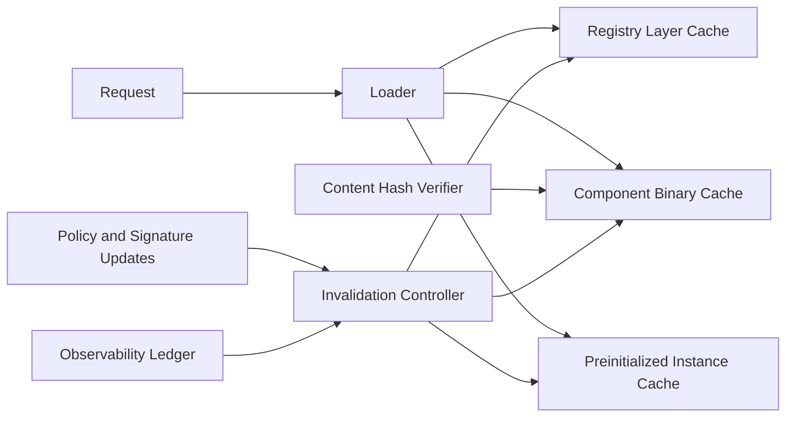

# Wasm Component 缓存层选型 FAQ（Cycle 1854）

## 1) 3 分钟结论
- **核心矛盾：** Wasm 组件冷加载会拉高首请求时延，但缓存层过宽会带来版本漂移与污染风险。
- **推荐：** 分层缓存（镜像层/组件层/实例层）+ 内容哈希锁定 + 失效回滚联动。
- **目标：** 在保证版本一致性的前提下压低冷启动抖动与重复拉取成本。

## 2) Q1 / Q2 / Q3
### Q1：为什么“只做镜像缓存”不够？
1) 镜像命中后组件初始化仍可能重复耗时；
2) 组件依赖树变化会造成隐性缓存失效；
3) 多租户共享时难以保证隔离与版本一致。

### Q2：生产级 Wasm 组件缓存策略应如何设计？
- **三层缓存：** registry 镜像缓存、组件二进制缓存、实例预初始化缓存；
- **哈希锁定：** 组件按内容摘要寻址，避免标签漂移；
- **失效策略：** 签名变更、依赖漂移、策略升级触发主动失效；
- **回滚联动：** 缓存失效异常时回退到上一稳定缓存快照。

### Q3：如何验证缓存层“快且稳”？
- 冷启动 P95 与组件拉取时延下降；
- 版本不一致事件下降；
- 缓存命中率提升且误命中率可控。

## 3) 架构图

## 4) 选型矩阵
| 维度 | 单层镜像缓存 | 三层组件缓存（推荐） |
|---|---:|---:|
| 冷启动优化 | 中 | 高 |
| 版本一致性 | 低 | 高 |
| 缓存命中质量 | 中 | 高 |
| 实施复杂度 | 低 | 中 |
| 多租户隔离 | 低 | 高 |

## 5) 证据与复算口径
- 证据文件：
  - `workshops/azure-agent-infra/evidence/cycle-1854-benchmark.json`
  - `workshops/azure-agent-infra/evidence/cycle-1854-latency.csv`
  - `workshops/azure-agent-infra/evidence/cycle-1854-throughput.csv`
  - `workshops/azure-agent-infra/evidence/cycle-1854-policy.csv`
- 标签：`measured / synthetic / anonymized_reported`。
- validation7：双语六段结构、7-card CSP 自包含、轮次与 evidence 一致、可回放链路通过。

## 6) 生产检查清单
- [ ] 三层缓存路径配置与优先级生效。
- [ ] 内容哈希锁定与签名校验联调通过。
- [ ] 失效触发与回滚快照流程可回放。
- [ ] 命中率/误命中率/时延指标达标。
- [ ] FAQ/H5/SVG/7-card 与 evidence 轮次一致。
