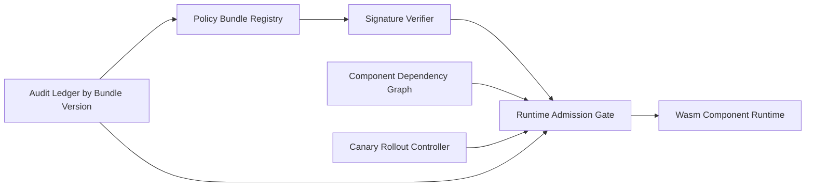

# Wasm Component Policy Bundle Selection FAQ (Cycle 1873)

## 1) Three-minute decision
- **Core issue:** fragmented policies in componentized Wasm runtime lead to cross-component permission drift and weak audit continuity.
- **Recommendation:** policy bundles with signed versions and runtime-enforced validation.
- **Goal:** make runtime policy governance releaseable, verifiable, and rollback-ready.

## 2) Q1 / Q2 / Q3
### Q1: Why is per-component scattered policy risky?
1) dependency graphs change rapidly,
2) environment drift causes policy inconsistency,
3) rollback lacks a unified version anchor.

### Q2: What should production policy bundles include?
- **Bundle unit:** permissions, quotas, IO boundaries, and audit rules,
- **Version signatures:** signed bundle versions for tamper resistance,
- **Runtime checks:** mandatory compatibility checks before component admission,
- **Canary rollout:** low-risk tenant rollout before broad promotion.

### Q3: What is the go-live bar?
- failed bundle validation can rollback quickly,
- cross-environment policy consistency is proven,
- audit trails map cleanly to bundle versions.

## 3) Reference architecture

## 4) Decision matrix
| Dimension | Scattered policy config | Policy bundle (Recommended) |
|---|---:|---:|
| Policy consistency | Low | High |
| Tamper resistance | Low | High |
| Rollback efficiency | Low | High |
| Implementation complexity | Low | Medium |
| Audit traceability | Medium | High |

## 5) Evidence and reproducibility
- Evidence files:
  - `workshops/azure-agent-infra/evidence/cycle-1873-benchmark.json`
  - `workshops/azure-agent-infra/evidence/cycle-1873-latency.csv`
  - `workshops/azure-agent-infra/evidence/cycle-1873-throughput.csv`
  - `workshops/azure-agent-infra/evidence/cycle-1873-policy.csv`
- Labels: `measured / synthetic / anonymized_reported`.
- validation7 enforces six-part structure, CSP-safe 7-card output, strict cycle-topic alignment, and replayable checks.

## 6) Production checklist
- [ ] Bundle metadata and signature paths are integrated.
- [ ] Runtime admission checks are validated.
- [ ] Canary rollout and rollback drills pass.
- [ ] Audit trail is complete by bundle version.
- [ ] FAQ/H5/SVG/7-card/evidence remain cycle-consistent.
