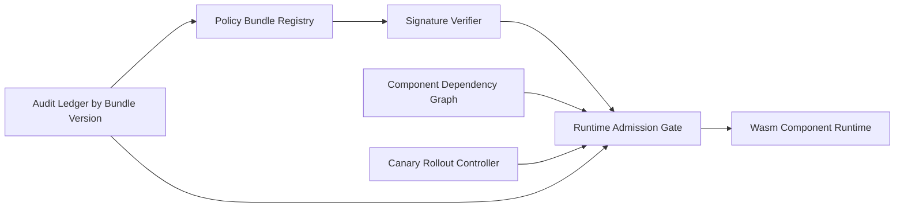

# Wasm Component Policy Bundle 选型 FAQ（Cycle 1873）

## 1) 3 分钟结论
- **核心问题：** Wasm 组件化执行若策略分散，易导致跨组件权限漂移与审计断层。
- **推荐方案：** “策略打包（policy bundle）+ 版本签名 + 运行时强校验”。
- **目标：** 让组件执行策略具备可发布、可验证、可回滚的生产治理能力。

## 2) Q1 / Q2 / Q3
### Q1：为什么按组件零散配置策略有风险？
1) 组件依赖图变化快，策略漂移难追踪；
2) 环境差异导致同组件策略不一致；
3) 回滚时缺少统一版本锚点。

### Q2：生产级 policy bundle 如何设计？
- **打包单元：** 权限、资源限额、IO 边界、审计规则统一打包；
- **版本签名：** bundle 版本号 + 签名校验防篡改；
- **运行时校验：** 组件启动前强制校验 bundle 兼容性；
- **灰度发布：** 新 bundle 先在低风险租户灰度验证。

### Q3：上线判据是什么？
- bundle 校验失败可快速回退；
- 跨环境执行策略一致性达标；
- 审计链能按 bundle 版本追溯。

## 3) 架构图

## 4) 选型矩阵
| 维度 | 零散策略配置 | Policy Bundle（推荐） |
|---|---:|---:|
| 策略一致性 | 低 | 高 |
| 防篡改能力 | 低 | 高 |
| 回滚效率 | 低 | 高 |
| 实施复杂度 | 低 | 中 |
| 审计可追溯性 | 中 | 高 |

## 5) 证据与复算口径
- 证据文件：
  - `workshops/azure-agent-infra/evidence/cycle-1873-benchmark.json`
  - `workshops/azure-agent-infra/evidence/cycle-1873-latency.csv`
  - `workshops/azure-agent-infra/evidence/cycle-1873-throughput.csv`
  - `workshops/azure-agent-infra/evidence/cycle-1873-policy.csv`
- 标签：`measured / synthetic / anonymized_reported`。
- validation7：六段结构、7-card CSP、cycle-topic 对齐、验证链可回放。

## 6) 生产检查清单
- [ ] bundle 元数据与签名机制联调通过。
- [ ] 运行时 admission gate 校验路径验证通过。
- [ ] 灰度发布与回滚演练通过。
- [ ] 审计按 bundle 版本可完整追踪。
- [ ] FAQ/H5/SVG/7-card/evidence 轮次一致。
