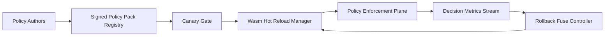

# Wasm Policy Pack Hot Reload Selection FAQ (Cycle 1894)

## 1) Three-minute decision
- **Core issue:** if multi-tenant agent gateways require restarts for policy updates, policy rollout latency and traffic jitter increase.
- **Recommendation:** combine Wasm policy-pack hot reload, version gates, and rollback fuses.
- **Goal:** deliver minute-level policy rollout and traceable rollback without session interruption.

## 2) Q1 / Q2 / Q3
### Q1: Why is hot policy reload a production requirement?
1) risk and compliance rules change frequently,
2) full restarts reduce availability,
3) multi-region rollout needs consistency and rollback windows.

### Q2: How should production hot reload be designed?
- **Versioned packs:** each pack carries signature and version fingerprint,
- **Canary gates:** validate on limited traffic before ramp-up,
- **Rollback fuse:** auto-revert on false-positive/false-negative drift,
- **Observability loop:** track block rate, false-positive rate, and load latency.

### Q3: What is the go-live bar?
- faster policy update with no session interruption,
- false-positive and miss rates within thresholds,
- controlled and auditable rollback mean time.

## 3) Reference architecture

## 4) Decision matrix
| Dimension | Restart-based updates | Hot Reload + Rollback (Recommended) |
|---|---:|---:|
| Activation speed | Low | High |
| Session continuity | Low | High |
| Risk controllability | Medium | High |
| Implementation complexity | Low | Medium |
| Audit traceability | Medium | High |

## 5) Evidence and reproducibility
- Evidence files:
  - `workshops/azure-agent-infra/evidence/cycle-1894-benchmark.json`
  - `workshops/azure-agent-infra/evidence/cycle-1894-latency.csv`
  - `workshops/azure-agent-infra/evidence/cycle-1894-throughput.csv`
  - `workshops/azure-agent-infra/evidence/cycle-1894-policy.csv`
- Labels: `measured / synthetic / anonymized_reported`.
- Validation chain: six-part FAQ, CSP, cycle/topic binding, simulator checks.

## 6) Production checklist
- [ ] Wasm policy-pack signatures are verifiable.
- [ ] Canary gates support tenant/region staged rollout.
- [ ] False-positive/false-negative thresholds trigger rollback fuse.
- [ ] Decision and rollback events are version-traceable.
- [ ] FAQ/H5/SVG/7-card/evidence stay cycle-consistent.
