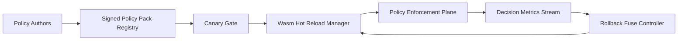

# Wasm Policy Pack Hot Reload 选型 FAQ（Cycle 1894）

## 1) 3 分钟结论
- **核心问题：** 多租户 Agent 网关若策略包更新需重启实例，会造成策略生效延迟与流量抖动。
- **推荐方案：** “Wasm policy pack 热加载 + 版本闸门 + 回滚保险丝”组合。
- **目标：** 在不中断会话的前提下实现策略分钟级发布与可追溯回滚。

## 2) Q1 / Q2 / Q3
### Q1：为什么策略热加载是生产刚需？
1) 风控与合规规则更新频繁；
2) 全量重启会带来可用性损失；
3) 多区域发布需要一致性与回滚窗口。

### Q2：生产级 hot reload 架构怎么做？
- **策略包版本化：** 每个 pack 带签名与版本指纹；
- **灰度闸门：** 先小流量验证后逐步放量；
- **回滚保险丝：** 触发误杀/漏拦时自动回退；
- **观测闭环：** 跟踪拦截率、误报率、加载时延。

### Q3：上线判据是什么？
- 策略更新时间缩短且不中断会话；
- 误报率与漏报率维持阈值内；
- 回滚平均耗时可控且可审计。

## 3) 架构图

## 4) 选型矩阵
| 维度 | 重启式更新 | Hot Reload + Rollback（推荐） |
|---|---:|---:|
| 生效时效 | 低 | 高 |
| 会话连续性 | 低 | 高 |
| 风险可控性 | 中 | 高 |
| 实施复杂度 | 低 | 中 |
| 审计可追溯 | 中 | 高 |

## 5) 证据与复算口径
- 证据文件：
  - `workshops/azure-agent-infra/evidence/cycle-1894-benchmark.json`
  - `workshops/azure-agent-infra/evidence/cycle-1894-latency.csv`
  - `workshops/azure-agent-infra/evidence/cycle-1894-throughput.csv`
  - `workshops/azure-agent-infra/evidence/cycle-1894-policy.csv`
- 标签：`measured / synthetic / anonymized_reported`。
- 校验链：FAQ 六段、CSP、cycle/topic 绑定、模拟器检查。

## 6) 生产检查清单
- [ ] Wasm policy pack 版本签名可验证。
- [ ] 灰度发布闸门支持分租户分区域放量。
- [ ] 误报/漏报阈值触发自动回滚保险丝。
- [ ] 决策与回滚事件可追溯到具体版本。
- [ ] FAQ/H5/SVG/7-card/evidence 轮次一致。
