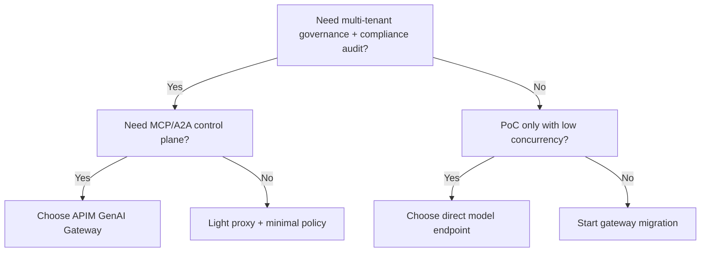
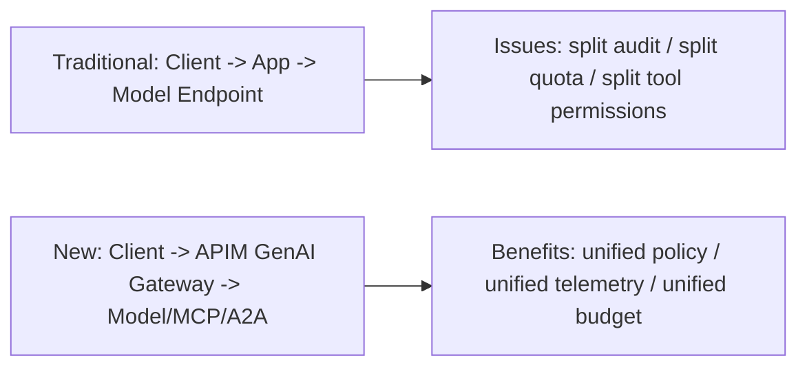
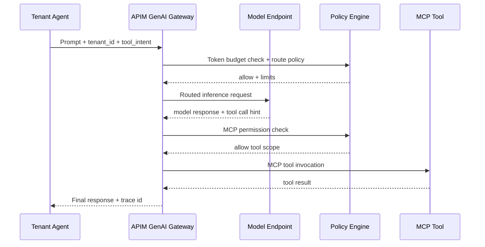

# APIM GenAI Gateway Selection FAQ (Architecture & First Principles)

> Scope lock: **this FAQ focuses on one topic only** — AI Gateway selection (APIM GenAI Gateway vs direct model endpoint / light proxy).

## 1) 📌 Executive Summary (3-minute read)

1. **Choose APIM GenAI Gateway when you need production-grade governance, auditability, and budget control for Agent traffic.**  
   First principle: the risk is not one inference call; it is the *continuous call chain* across model, MCP tools, and A2A exchanges.
2. **Choose direct endpoint/light proxy for short-lived PoC, low concurrency, single-tenant, low-compliance scenarios.**  
   First principle: fewer layers reduce initial setup cost, but observability and policy controls are fragmented.
3. **The architecture inflection point appears when multi-tenant scale, cost control, and compliance arrive together.**  
   First principle: once unified token budget, quota, policy interception, and evidence retention are required, gateway becomes mandatory.

## 2) 🎯 Hard Questions Q&A

### Q1: When should I pick A (APIM GenAI Gateway) vs B (direct/light proxy)?

- Pick **A** when multi-model routing, MCP tool governance, A2A policy, tenant quotas, and audit trail are hard requirements.  
- Pick **B** when you only need rapid internal validation with low blast radius.

### Q2: Which scenarios are strictly better for B?

- Early-stage PoC (1–2 weeks), rapidly changing requirements, unknown model/tool boundaries.  
- Primary goal is speed of feedback, not long-term operational reliability.

### Q3: What is the core mechanism (MCP routing + token governance), and why does it matter?

- **MCP routing** turns tool invocation from app-level hardcoding into governed gateway routing rules.  
  - Pain solved: scattered tool integrations, unclear permission boundary, weak audit trail.  
  - How it works: gateway evaluates tenant/tool/policy attributes and routes requests to approved tool paths.
- **Token governance** enforces budget, quota, and circuit-breakers for model usage.  
  - Pain solved: runaway costs and tenant contention under shared capacity.  
  - How it works: budget counters + quota thresholds + deterministic over-limit actions (deny/degrade/queue).

## 3) 🧭 Visual Explanations (Mermaid)

## 4) 📊 Architect Decision Matrix

| Dimension | APIM GenAI Gateway | Direct Endpoint / Light Proxy |
|---|---|---|
| Multi-tenant governance | Strong | Weak (custom logic required) |
| MCP/A2A controllability | Strong | Medium-to-weak |
| Time-to-first-release | Medium | Fast |
| Operational complexity | Medium-to-high | Low |
| Compliance auditability | Strong | Weak |
| Long-term TCO | Better at scale | Lower early, often higher later |

## 5) 🧪 Quantitative Example + Benchmark Insight

> Evidence source: `evidence/cycle-382-benchmark.json` (sealed evidence) and corresponding 7-card deck.

| Metric | Gateway path (primary) | Baseline path (light proxy / fragmented governance) | Inflection insight |
|---|---:|---:|---|
| 1x load latency | 99ms | 910ms | restore-path delta is dominant |
| 5x load latency | 136ms | 1090ms | queueing overhead grows on baseline |
| 10x load latency | 158ms | 1360ms | gateway policy path stays stable at high concurrency |
| MCP throughput p50 | 640 RPS | 460 RPS | unified routing reduces duplicated overhead |
| Session cost (20 min) | \$0.00483 | \$0.00996 (Kata baseline) | cost breakpoint favors gateway at sustained scale |

7-card (4:5, CSP self-contained):
- ZH: `benchmark-cards.html`
- EN: `benchmark-cards.en.html`

## 6) 🛠️ Architect Checklist (Execution-ready)

- [ ] Define tenant budget policy (hard/soft thresholds + circuit action)
- [ ] Define MCP tool allowlist and minimum-privilege boundary
- [ ] Add trace IDs and retention policy for A2A interactions
- [ ] Gate 1x/5x/10x latency and throughput in CI checks
- [ ] Establish per-tenant / per-session / per-model cost observability
- [ ] Prepare rollback path between direct and gateway architectures
- [ ] Drill three failures: quota exhaustion, policy false positive, downstream timeout

