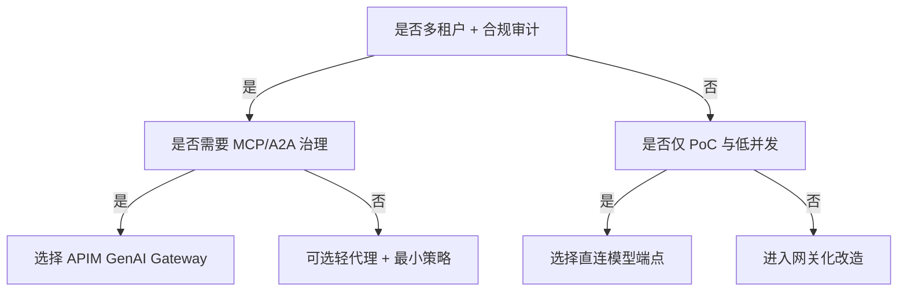
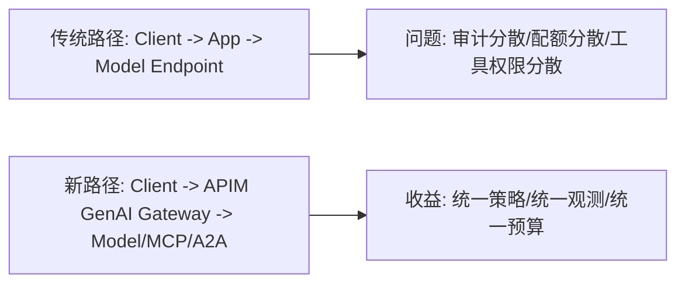
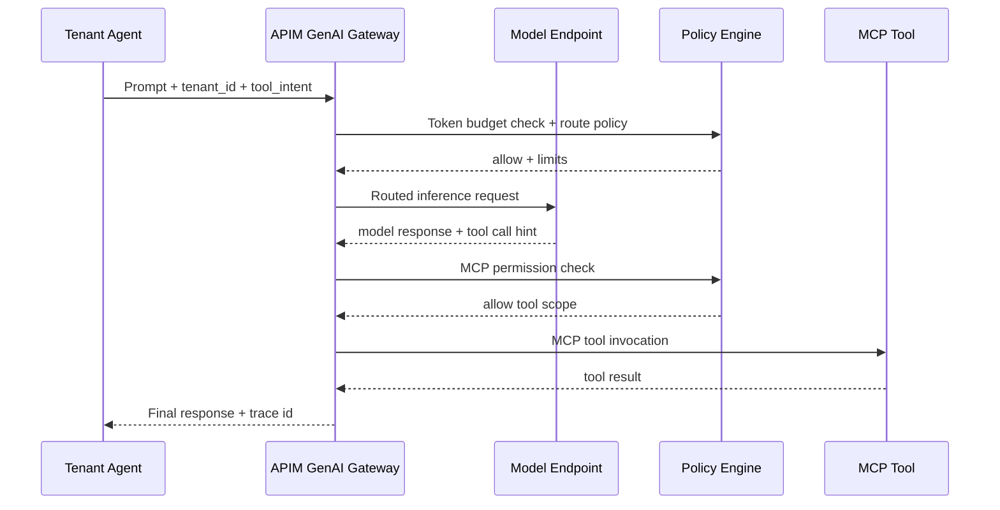

# APIM GenAI Gateway 选型 FAQ（架构与原理解析）

> 主题收敛：**仅讨论 AI Gateway 选型**（APIM GenAI Gateway vs 直连模型端点/轻量反向代理），不扩展到其他专题。

## 1) 📌 Executive Summary（3 分钟结论）

1. **当你需要“可审计、可治理、可限流”的生产级 Agent 流量平面时，优先选 APIM GenAI Gateway。**  
   第一性原理：Agent 系统的风险不在“单次推理”，而在“持续调用链”；必须把模型调用、MCP 工具调用、A2A 消息交换纳入统一控制面。
2. **当你只做短期 PoC、低并发、单租户、低合规要求时，直连端点更快上线。**  
   第一性原理：少一层网关，路径更短，初始复杂度更低，但可观测与策略治理能力显著下降。
3. **规模化拐点通常出现在“多租户 + 成本预算 + 合规审计”同时出现时。**  
   第一性原理：一旦需要统一令牌预算、配额、策略拦截和证据留存，网关层从“可选”变成“必需”。

## 2) 🎯 灵魂拷问 Q&A

### Q1：什么时候选 A（APIM GenAI Gateway）vs B（直连/轻代理）？

- 选 **A**：多模型路由、MCP 工具网关化、A2A 治理、租户配额、审计追踪是硬需求。  
- 选 **B**：单团队内测、无严格审计、生命周期短、并发低、故障可人工兜底。

### Q2：什么场景 B 严格更优？

- 仅做原型验证（1–2 周）、需求高频变更、尚未确定模型/工具边界；  
- 核心目标是最快拿到业务反馈，而非长期运营稳定性。  

### Q3：核心技术 X（MCP 路由 + 令牌治理）是什么？解决什么痛点？底层如何运作？

- **MCP（Model Context Protocol）路由**：把工具调用从“应用内硬编码”升级为“可治理的网关路由规则”。  
  - 解决痛点：工具接入杂乱、权限边界不清、审计不可追。  
  - 底层机制：在网关侧按工具类型/租户/策略进行请求分流与策略匹配。  
- **令牌治理（Token Governance）**：对 token 成本进行预算、限流和熔断。  
  - 解决痛点：多租户下成本失控、热点租户抢占资源。  
  - 底层机制：预算计数器 + 配额阈值 + 超限动作（拒绝/降级/排队）。  

## 3) 🧭 可视化图解（Mermaid）

## 4) 📊 Architect Decision Matrix

| 维度 | APIM GenAI Gateway | 直连模型端点 / 轻代理 |
|---|---|---|
| 多租户治理 | 强（租户级策略、配额、预算） | 弱（需业务层自研） |
| MCP/A2A 可控性 | 强（统一入口可审计） | 中-弱（分散接入） |
| 上线速度 | 中 | 快 |
| 运行复杂度 | 中-高（初期配置较多） | 低 |
| 合规审计 | 强（统一日志与策略证据） | 弱（证据分散） |
| 长期 TCO | 更优（规模化后） | 前期低、后期常升高 |

## 5) 🧪 定量算例 + Benchmark 洞察

> 数据来源：`evidence/cycle-382-benchmark.json`（sealed evidence），并同步到 7-Card 可视化卡组。

| 指标 | Gateway 化路径（主） | 基线路径（轻代理/分散治理） | 拐点解释 |
|---|---:|---:|---|
| 1x 负载延迟 | 99ms | 910ms | 冷启动/恢复路径差距明显 |
| 5x 负载延迟 | 136ms | 1090ms | 调度与排队成本在基线放大 |
| 10x 负载延迟 | 158ms | 1360ms | 高并发下网关治理更稳定 |
| MCP 吞吐 p50 | 640 RPS | 460 RPS | 统一路由减少重复开销 |
| 单会话成本（20min） | \$0.00483 | \$0.00996（Kata 基线） | 成本拐点出现在高并发多租户 |

7-Card（4:5，CSP 自包含）：
- 中文：`benchmark-cards.html`
- English：`benchmark-cards.en.html`

## 6) 🛠️ Architect Checklist（可执行）

- [ ] 明确租户分层与预算策略（硬阈值/软阈值/熔断动作）
- [ ] 定义 MCP 工具白名单与权限边界（最小权限原则）
- [ ] 为 A2A 消息链路配置追踪 ID 与审计保留周期
- [ ] 建立 1x/5x/10x 负载的延迟与吞吐门禁
- [ ] 设定成本观察窗（按租户、按会话、按模型）
- [ ] 对比直连路径与网关路径的回滚预案
- [ ] 演练“配额耗尽/策略误杀/下游超时”三类故障

