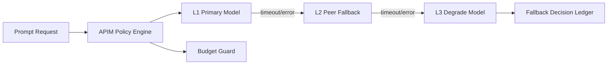

# APIM Multi-Model Fallback Policy Order Selection FAQ (Cycle 1776)

## 1) Three-minute decision
- **Multi-model stability depends on fallback order policy, not model count.**
- **Recommendation:** define layered primary/peer/degrade routes with per-layer timeout budgets.
- **Goal:** preserve critical success under model or regional faults while controlling latency and cost amplification.

## 2) Core questions (Q1/Q2/Q3)
### Q1: Why adding more fallback models can hurt?
1) longer chains increase end-to-end timeout risk,
2) semantic drift across models can destabilize outputs,
3) unbounded retries inflate token cost.

### Q2: How should fallback order be structured?
- L1 primary route: high quality/low variance,
- L2 peer fallback: similar capability, region-diverse,
- L3 degrade route: lower-cost fast safety net.

### Q3: How to validate effectiveness?
- critical success remains stable under fault injection,
- average fallback hops stay within budget,
- no cascade spikes in cost/latency curves.

## 3) Reference architecture

## 4) Decision matrix
| Dimension | No layered fallback order | Layered order + budgets (Recommended) |
|---|---:|---:|
| Fault resilience | Medium | High |
| Latency control | Low | High |
| Cost predictability | Low | High |
| Implementation complexity | Low | Medium |
| Output consistency | Medium | High |

## 5) Evidence and reproducibility
- Evidence files:
  - `workshops/azure-agent-infra/evidence/cycle-1776-benchmark.json`
  - `workshops/azure-agent-infra/evidence/cycle-1776-latency.csv`
  - `workshops/azure-agent-infra/evidence/cycle-1776-throughput.csv`
  - `workshops/azure-agent-infra/evidence/cycle-1776-cost.csv`
- Labels: `measured / synthetic / anonymized_reported`.
- validation7 requires bilingual structure, CSP self-contained cards, evidence consistency, and replayability trace.

## 6) Production checklist
- [ ] Each fallback layer has timeout/retry budgets.
- [ ] Maximum fallback hop count is policy bounded.
- [ ] Degrade-model consistency has monitor thresholds.
- [ ] Fallback decisions are audit-ledgered.
- [ ] FAQ/H5/SVG/7-card references are cycle-aligned.
