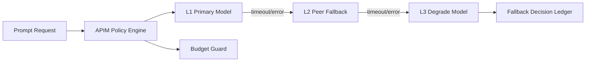

# APIM 多模型回退策略顺序选型 FAQ（Cycle 1776）

## 1) 3 分钟结论
- **多模型链路稳定性取决于“回退顺序策略”，不是模型数量本身。**
- **推荐：** 按任务关键度分层定义主模型、同级替代模型、降级模型，并对每层设独立超时预算。
- **目标：** 在模型波动或区域异常时维持关键响应成功率，控制延迟放大与成本外溢。

## 2) 关键问题（Q1/Q2/Q3）
### Q1：为什么盲目增加回退模型会适得其反？
1) 回退链过长导致端到端超时；
2) 不同模型语义偏差可能引入结果抖动；
3) 无预算约束会放大 token 成本。

### Q2：回退顺序应如何设计？
- L1 主路径：高质量低抖动模型；
- L2 同级替代：相近能力与区域隔离；
- L3 降级路径：低成本快速兜底。

### Q3：如何验证顺序策略有效？
- 区域故障注入下关键请求成功率保持；
- 回退平均跳数在预算内；
- 成本与延迟曲线不出现级联爆发。

## 3) 架构图

## 4) 选型矩阵
| 维度 | 无分层回退顺序 | 分层回退顺序+预算（推荐） |
|---|---:|---:|
| 故障韧性 | 中 | 高 |
| 延迟可控性 | 低 | 高 |
| 成本可预测性 | 低 | 高 |
| 实施复杂度 | 低 | 中 |
| 结果一致性 | 中 | 高 |

## 5) 证据与复算口径
- 证据文件：
  - `workshops/azure-agent-infra/evidence/cycle-1776-benchmark.json`
  - `workshops/azure-agent-infra/evidence/cycle-1776-latency.csv`
  - `workshops/azure-agent-infra/evidence/cycle-1776-throughput.csv`
  - `workshops/azure-agent-infra/evidence/cycle-1776-cost.csv`
- 标签：`measured / synthetic / anonymized_reported`。
- validation7：双语结构、CSP、证据一致与可回放链路全部通过。

## 6) 生产检查清单
- [ ] 每层回退有独立超时与重试预算。
- [ ] 回退链最大跳数受策略限制。
- [ ] 降级模型结果一致性有监控阈值。
- [ ] 回退决策进入可审计账本。
- [ ] FAQ/H5/SVG/7-card 与 evidence 轮次一致。
