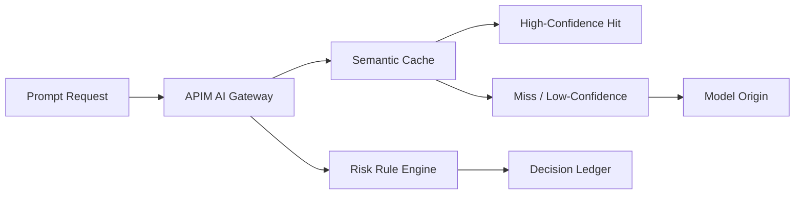

# APIM Semantic Cache Hit/Miss Governance Selection FAQ (Cycle 1766)

## 1) Three-minute decision
- **In AI Gateway, higher semantic-cache hit rate is not always better; hit quality and replay risk must be balanced.**
- **Recommendation:** domain-bucketed caching, confidence-tiered hit policy, and forced origin path for high-risk prompts.
- **Goal:** reduce token and latency costs without amplifying incorrect reuse across tenants.

## 2) Core questions (Q1/Q2/Q3)
### Q1: Why can high hit rate still cause incidents?
1) semantic near-match can replay stale answers,
2) tenant context differences can trigger cross-boundary responses,
3) sensitive prompts should not be amplified by cache reuse.

### Q2: What layers should governance include?
- semantic-domain isolation,
- confidence-tier hit policy,
- risk-rule bypass for sensitive requests.

### Q3: How to measure success?
- monitor both hit rate and false-hit rate,
- compare token cost and P95 latency pre/post governance,
- track sensitive-case wrong-reuse events.

## 3) Reference architecture

## 4) Decision matrix
| Dimension | Unified cache threshold | Domain/tier governance (Recommended) |
|---|---:|---:|
| Cost benefit | Medium | High |
| False-hit risk | High | Low |
| Tenant-isolation fitness | Low | High |
| Ops complexity | Low | Medium |
| Audit explainability | Medium | High |

## 5) Evidence and reproducibility
- Evidence files:
  - `workshops/azure-agent-infra/evidence/cycle-1766-benchmark.json`
  - `workshops/azure-agent-infra/evidence/cycle-1766-latency.csv`
  - `workshops/azure-agent-infra/evidence/cycle-1766-throughput.csv`
  - `workshops/azure-agent-infra/evidence/cycle-1766-cost.csv`
- Labels: `measured / synthetic / anonymized_reported`.
- validation7 requires bilingual structure, CSP self-contained cards, evidence consistency, and reproducible replay path.

## 6) Production checklist
- [ ] Semantic cache is segmented by tenant and scenario.
- [ ] Hit-threshold policy supports canary and rollback.
- [ ] High-risk prompts default to cache bypass.
- [ ] False-hit alerts and audit replay are available.
- [ ] FAQ/H5/SVG/7-card references are cycle-aligned.
