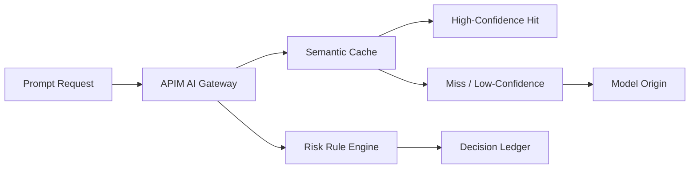

# APIM Semantic Cache 命中/失配治理选型 FAQ（Cycle 1766）

## 1) 3 分钟结论
- **AI Gateway 的 semantic cache 不是“命中越高越好”，关键是命中质量与错误复用风险平衡。**
- **推荐：** 按业务语义域分桶、按置信阈值分层命中、对高风险问答强制回源。
- **目标：** 降低 token 成本与延迟，同时避免错误缓存跨租户扩散。

## 2) 关键问题（Q1/Q2/Q3）
### Q1：为什么高命中率也可能带来事故？
1) 语义近似误判会把旧答案复用到新问题；
2) 租户上下文差异导致答复越权；
3) 风险问答不应被缓存放大。

### Q2：治理策略应包含哪些层？
- 语义域隔离：按场景/租户/权限域分桶；
- 命中阈值层：高置信命中、低置信回源；
- 风险规则层：敏感请求默认绕过缓存。

### Q3：如何衡量治理成效？
- 命中率与误命中率同时监控；
- 比较治理前后 token 成本与 P95 延迟；
- 统计敏感场景错误复用次数。

## 3) 架构图

## 4) 选型矩阵
| 维度 | 统一缓存阈值 | 分域分层治理（推荐） |
|---|---:|---:|
| 成本收益 | 中 | 高 |
| 误命中风险 | 高 | 低 |
| 租户隔离适配 | 低 | 高 |
| 运维复杂度 | 低 | 中 |
| 审计解释力 | 中 | 高 |

## 5) 证据与复算口径
- 证据文件：
  - `workshops/azure-agent-infra/evidence/cycle-1766-benchmark.json`
  - `workshops/azure-agent-infra/evidence/cycle-1766-latency.csv`
  - `workshops/azure-agent-infra/evidence/cycle-1766-throughput.csv`
  - `workshops/azure-agent-infra/evidence/cycle-1766-cost.csv`
- 标签：`measured / synthetic / anonymized_reported`。
- validation7：双语结构、CSP、证据一致与复算链路完整通过。

## 6) 生产检查清单
- [ ] 语义缓存按租户与场景隔离。
- [ ] 命中阈值支持灰度与回滚。
- [ ] 高风险请求默认绕过缓存。
- [ ] 误命中告警与审计回放可用。
- [ ] FAQ/H5/SVG/7-card 与 evidence 轮次一致。
