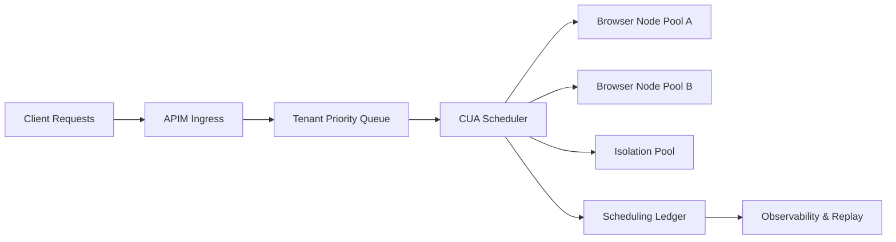

# Browser/CUA Cluster Scheduling Governance Selection FAQ (Cycle 1761)

## 1) Three-minute decision
- **The real bottleneck in Browser/CUA clusters is not per-node compute, but scheduling fairness and session lifecycle governance.**
- **Recommended pattern:** tenant-priority queues + session TTL + failure isolation pools.
- **Goal:** preserve critical-task completion under peak traffic while keeping resource jitter explainable.

## 2) Core questions (Q1/Q2/Q3)
### Q1: Why do clusters look “available” but fail scheduling at peak?
1) long-tail sessions occupy slots,
2) bursty tenants starve general traffic,
3) unhealthy sessions are not isolated from shared queues.

### Q2: How should scheduling be layered?
- L1: tenant quotas and priority classes,
- L2: task-class queues (critical vs standard),
- L3: session health-score driven recycle/migration.

### Q3: How do we prove governance effectiveness?
- replay fixed load scripts,
- compare critical completion rates with/without governance,
- report failure distributions and recovery latency.

## 3) Reference architecture

## 4) Decision matrix
| Dimension | Unified FIFO queue | Tiered scheduling + isolation pool (Recommended) |
|---|---:|---:|
| Implementation complexity | Low | Medium |
| Peak stability | Low | High |
| Critical-task assurance | Low | High |
| Failure blast radius | High | Low |
| Audit explainability | Medium | High |

## 5) Evidence and reproducibility
- Evidence files:
  - `workshops/azure-agent-infra/evidence/cycle-1761-benchmark.json`
  - `workshops/azure-agent-infra/evidence/cycle-1761-latency.csv`
  - `workshops/azure-agent-infra/evidence/cycle-1761-throughput.csv`
  - `workshops/azure-agent-infra/evidence/cycle-1761-policy.csv`
- Labels: `measured / synthetic / anonymized_reported`.
- validation7 requires bilingual structure, CSP self-containment, evidence consistency, and replayability narrative.

## 6) Production checklist
- [ ] Tenant-level priority and quota boundaries are configured and auditable.
- [ ] Session TTL and forced-recycle policies support safe rollout thresholds.
- [ ] Isolation pools absorb unhealthy sessions without poisoning main queues.
- [ ] Scheduling ledger explains each migration/recycle decision.
- [ ] FAQ/H5/SVG/7-card references are cycle-aligned.
