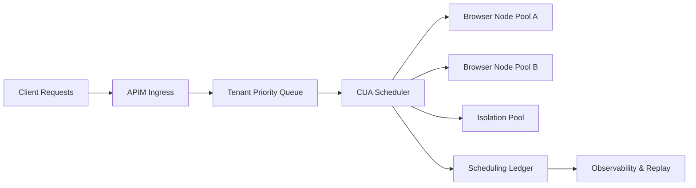

# Browser/CUA 集群调度治理选型 FAQ（Cycle 1761）

## 1) 3 分钟结论
- **Browser/CUA 集群的核心瓶颈不是单节点算力，而是会话调度公平性与回收治理。**
- **推荐策略：** 按租户优先级队列 + 会话 TTL + 失败隔离池，实现“高优先级可用、低优先级可退化”。
- **关键目标：** 在高并发时保持关键任务完成率，同时将资源抖动控制在可解释范围。

## 2) 核心问题（Q1/Q2/Q3）
### Q1：为什么 CUA 集群会在高峰“看起来有机器却不可用”？
1) 长尾会话占坑导致可调度槽位耗尽；
2) 热点租户瞬时放量挤压普通租户；
3) 异常会话未隔离，拖慢共享队列。

### Q2：调度策略如何分层？
- 一级：租户级配额与优先级；
- 二级：任务类型（关键路径/普通路径）队列；
- 三级：会话健康分数驱动回收与迁移。

### Q3：如何证明治理有效而非“碰运气”？
- 固定压测脚本回放同一流量包；
- 对比“无治理/有治理”关键任务完成率；
- 输出失败原因分布与恢复耗时统计。

## 3) 架构图

## 4) 选型矩阵
| 维度 | 统一 FIFO 队列 | 分层调度 + 隔离池（推荐） |
|---|---:|---:|
| 实现复杂度 | 低 | 中 |
| 高峰稳定性 | 低 | 高 |
| 关键任务保障 | 低 | 高 |
| 故障扩散风险 | 高 | 低 |
| 审计可解释性 | 中 | 高 |

## 5) 证据与复算口径
- 证据文件：
  - `workshops/azure-agent-infra/evidence/cycle-1761-benchmark.json`
  - `workshops/azure-agent-infra/evidence/cycle-1761-latency.csv`
  - `workshops/azure-agent-infra/evidence/cycle-1761-throughput.csv`
  - `workshops/azure-agent-infra/evidence/cycle-1761-policy.csv`
- 标签：`measured / synthetic / anonymized_reported`。
- 本轮要求：validation7=7/7，含双语结构、CSP、证据一致性和可回放说明。

## 6) 生产检查清单
- [ ] 租户级优先级与配额边界已配置并可审计。
- [ ] 会话 TTL 与强制回收策略具备灰度阈值。
- [ ] 隔离池可承接异常会话且不拖累主队列。
- [ ] 调度账本可解释每次迁移/回收决策。
- [ ] FAQ/H5/SVG/7-card 与 evidence 轮次一致。
