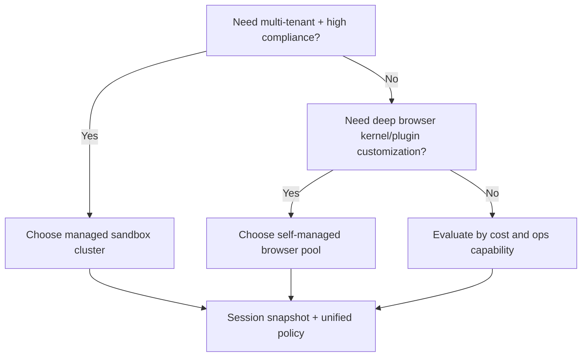
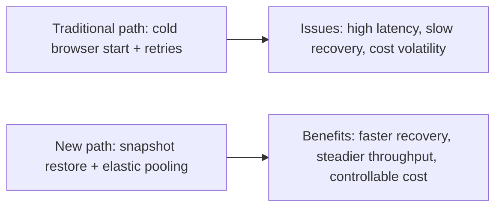
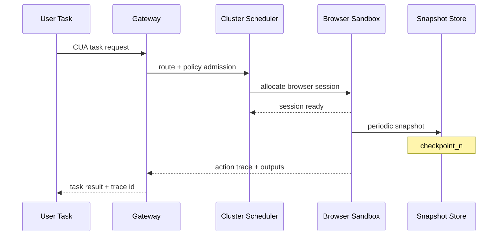

# Browser/CUA Cluster Selection FAQ (Managed Sandbox Cluster vs Self-Managed Browser Pool)

> Scope lock: this document focuses only on **production Browser/CUA cluster architecture selection**.

## 1) 📌 Executive Summary (3-minute read)

1. **Use managed sandbox clusters by default** for stronger isolation, safer governance, and smoother elastic scaling.  
2. **Self-managed browser pools are better only for deep customization and extreme cost tuning**, with much higher ops burden.  
3. **The real decision key is the combination of session persistence, burst concurrency, and compliance boundary**, not a single TPS number.

## 2) 🎯 Hard Questions Q&A

### Q1: When should I choose managed sandbox cluster (A) vs self-managed browser pool (B)?

- Choose **A** for multi-tenant, untrusted web execution, and high-compliance environments where ops simplicity matters.  
- Choose **B** when you need browser kernel/plugin customization and have a strong long-term platform/SRE capability.

### Q2: When is B strictly better?

- Stable long-running workload where static pooling can be highly optimized.  
- Compliance boundary is fully controlled by internal network and strong access controls.  
- Team can sustain continuous browser version, patch, and isolation maintenance.

### Q3: What is the core mechanism (session snapshot restore), what pain does it solve, and how does it work?

- **What**: recoverable browser session snapshots (state, context, execution progress).  
- **Pain solved**: expensive cold starts and slow recovery for long chains of actions.  
- **How**:  
  - periodic snapshot persistence during execution;  
  - failure recovery from nearest checkpoint instead of full rebuild;  
  - restoration tied to policy gate and full trace continuity.

## 3) 🧭 Visual Explanations (Mermaid)

## 4) 📊 Architect Decision Matrix

| Dimension | Managed Sandbox Cluster | Self-Managed Browser Pool |
|---|---|---|
| Isolation/security baseline | Strong | Medium (depends on platform capability) |
| Time-to-production | Strong | Medium-to-weak |
| Deep customization | Medium | Strong |
| Ops complexity | Low-medium | High |
| Cost predictability | Medium | Medium-high (if optimized) |
| Default recommendation | Recommended | Recommended only for strong platform teams |

## 5) 🧪 Quantitative Example + Benchmark Insight

> Data source: `evidence/cycle-387-benchmark.json` (sealed evidence) and corresponding 7-card deck.

| Metric | Managed sandbox cluster | Self-managed browser pool | Insight |
|---|---:|---:|---|
| Session restore p50 | 126ms | 174ms | managed snapshot lane restores more consistently |
| Session restore p95 | 198ms | 312ms | self-managed path jitters more at peak |
| Concurrency throughput p50 | 980 RPS | 910 RPS | managed scheduler is steadier for bursts |
| Policy interception coverage | 96%+ | 87% | centralized policy lane improves coverage |
| Session cost (20 min) | $0.0067 | $0.0059 | self-managed can be cheaper but requires ops staffing |

7-card (4:5, CSP self-contained): `benchmark-cards.html` / `benchmark-cards.en.html`

## 6) 🛠️ Architect Checklist

- [ ] Define session lifecycle and snapshot restore policy  
- [ ] Enforce cross-tenant isolation and egress controls  
- [ ] Establish browser version and patch governance cadence  
- [ ] Gate restore latency, throughput, and interception metrics before release  
- [ ] Evaluate full TCO (infra + ops labor)  
- [ ] Prepare burst-capacity and graceful degradation plans  
- [ ] Run adversarial page and privilege-escalation drills  

