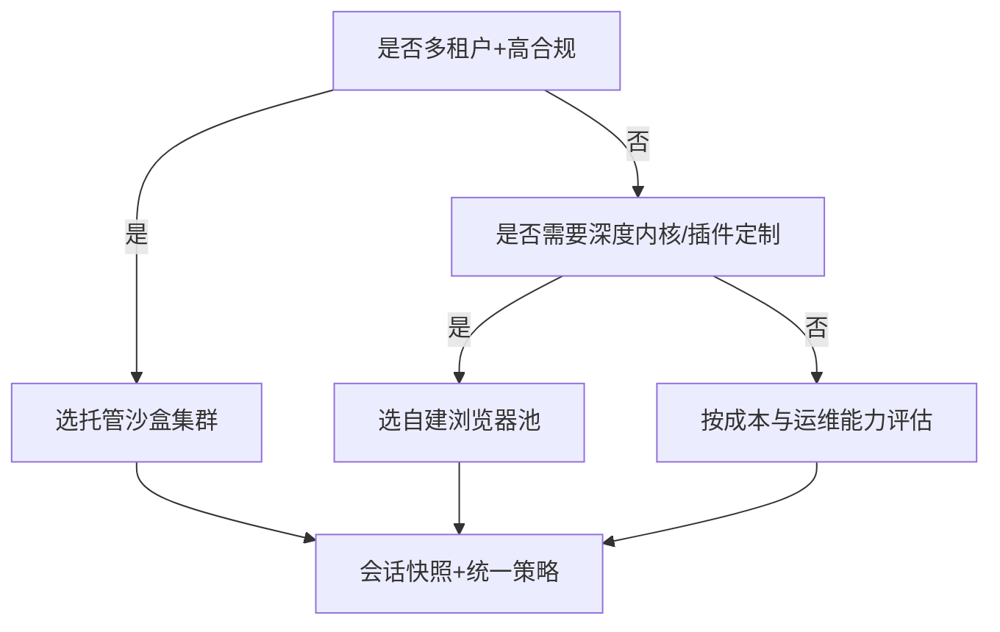
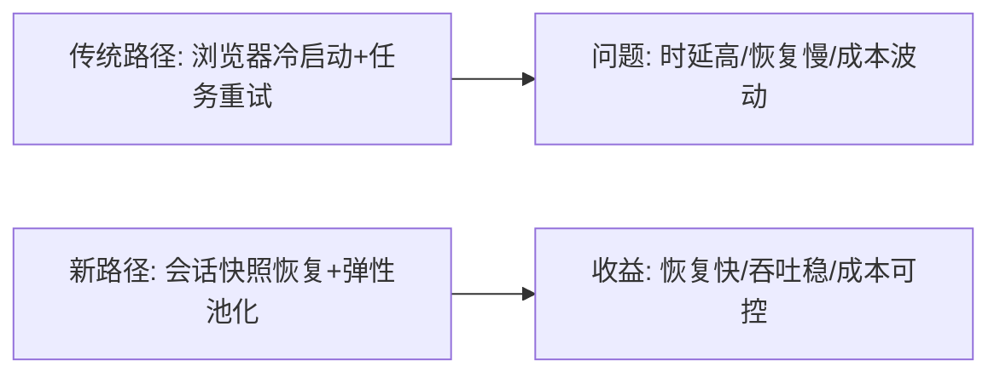
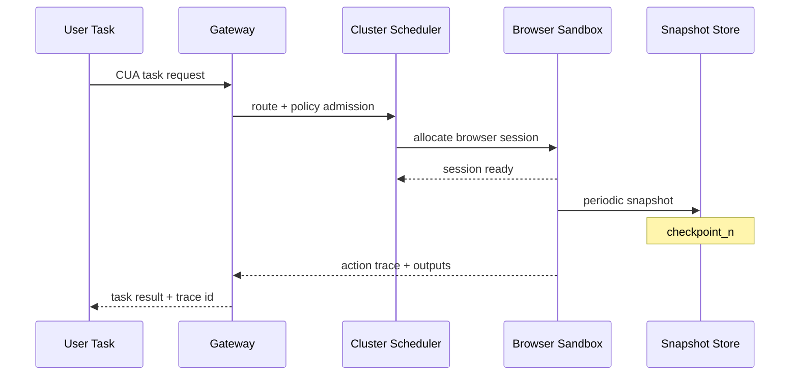

# Browser/CUA 集群架构选型 FAQ（托管沙盒集群 vs 自建浏览器池）

> 专题边界：仅讨论 **Browser/CUA（Computer Use Agent）集群** 生产架构选型。

## 1) 📌 Executive Summary（3 分钟结论）

1. **默认优先托管沙盒集群**：在隔离、安全与弹性方面更稳，适合多租户规模化。  
2. **自建浏览器池仅在强定制与极限成本压缩时更优**：但运维复杂度显著增加。  
3. **关键决策点是“会话持久性 + 并发突发 + 合规边界”三者组合，而不是单一 TPS。**

## 2) 🎯 灵魂拷问 Q&A

### Q1：什么时候选托管沙盒集群（A）vs 自建浏览器池（B）？

- 选 **A**：  
  - 多租户、不可信网页执行、合规要求高；  
  - 希望用平台能力换取更低运维负担。  
- 选 **B**：  
  - 需要浏览器内核定制、特定插件生态、极度细粒度成本优化；  
  - 有成熟 SRE/平台团队长期维护。

### Q2：什么场景下 B 严格更优？

- 业务长期固定、访问模式稳定，可通过静态池化做到高利用率；  
- 合规边界可由内网与强访问控制完全覆盖；  
- 有能力承担浏览器版本、补丁、隔离策略持续维护。

### Q3：核心技术 X（会话快照恢复）是什么？解决什么痛点？底层如何运作？

- **是什么**：对浏览器会话状态做可恢复快照（DOM 上下文、存储、执行状态）。  
- **解决痛点**：每次冷启动浏览器成本高、长链任务中断恢复慢。  
- **底层运作**：  
  - 周期性持久化会话状态；  
  - 失败时从最近快照恢复而非全量重建；  
  - 与策略网关联动，恢复后继续追踪与审计。

## 3) 🧭 可视化图解（Mermaid）

## 4) 📊 Architect Decision Matrix

| 维度 | 托管沙盒集群 | 自建浏览器池 |
|---|---|---|
| 隔离与安全基线 | 强 | 中（取决于自建能力） |
| 快速上线能力 | 强 | 中-弱 |
| 深度定制能力 | 中 | 强 |
| 运维复杂度 | 低-中 | 高 |
| 成本可预测性 | 中 | 中-高（优化得当时） |
| 生产默认建议 | 推荐 | 仅强平台团队推荐 |

## 5) 🧪 定量算例 + Benchmark 洞察

> 数据来源：`evidence/cycle-387-benchmark.json`（sealed evidence）与 7-Card 卡组。

| 指标 | 托管沙盒集群 | 自建浏览器池 | 洞察 |
|---|---:|---:|---|
| 会话恢复 p50 | 126ms | 174ms | 托管快照路径恢复更稳 |
| 会话恢复 p95 | 198ms | 312ms | 自建路径峰值抖动更明显 |
| 并发吞吐 p50 | 980 RPS | 910 RPS | 托管调度在突发更稳 |
| 策略拦截覆盖率 | 96%+ | 87% | 集中策略面优势明显 |
| 单会话成本（20 分钟） | $0.0067 | $0.0059 | 自建更低但需计入运维人力 |

7-Card（4:5，CSP 自包含）：`benchmark-cards.html` / `benchmark-cards.en.html`

## 6) 🛠️ Architect Checklist

- [ ] 定义会话生命周期与快照恢复策略  
- [ ] 设定跨租户隔离边界与网络出站策略  
- [ ] 建立浏览器版本与补丁治理节奏  
- [ ] 对恢复时延、吞吐、拦截率设置发布门禁  
- [ ] 评估“资源成本 + 人力运维成本”综合 TCO  
- [ ] 建立高峰突发容量与降级预案  
- [ ] 进行越权访问与恶意页面对抗演练  

