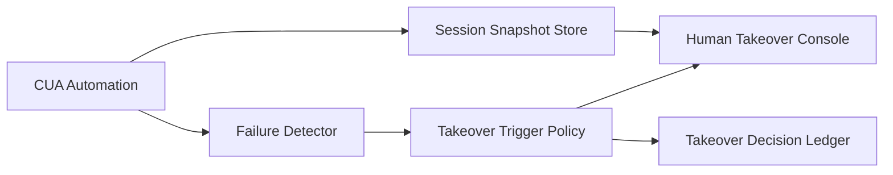

# Browser/CUA Human Takeover Latency Selection FAQ (Cycle 1781)

## 1) Three-minute decision
- **Browser/CUA operational resilience is bounded by human-takeover latency, not average automation success.**
- **Recommendation:** prewarmed takeover channel + tiered takeover triggers + synchronized session snapshots.
- **Goal:** keep takeover time in seconds when automation fails, preventing workflow discontinuity.

## 2) Core questions (Q1/Q2/Q3)
### Q1: Why does slow takeover amplify incidents?
1) context expires quickly after automation failure,
2) browser state is hard to transfer manually,
3) queue backlog grows while waiting for intervention.

### Q2: What is the minimum low-latency takeover chain?
- pre-authorized takeover entry bound to session,
- failure-tier triggered takeover policies,
- automatic snapshot persistence before takeover.

### Q3: How to validate capability?
- takeover P95 latency meets SLA,
- post-takeover recovery success remains stable,
- takeover events are fully replayable for audit.

## 3) Reference architecture

## 4) Decision matrix
| Dimension | Manual operator attach | Prewarmed takeover + snapshots (Recommended) |
|---|---:|---:|
| Takeover latency | High | Low |
| Recovery success | Medium | High |
| Implementation complexity | Low | Medium |
| Audit completeness | Medium | High |
| Business continuity | Medium | High |

## 5) Evidence and reproducibility
- Evidence files:
  - `workshops/azure-agent-infra/evidence/cycle-1781-benchmark.json`
  - `workshops/azure-agent-infra/evidence/cycle-1781-latency.csv`
  - `workshops/azure-agent-infra/evidence/cycle-1781-throughput.csv`
  - `workshops/azure-agent-infra/evidence/cycle-1781-policy.csv`
- Labels: `measured / synthetic / anonymized_reported`.
- validation7 requires bilingual structure, CSP self-contained cards, evidence consistency, and replayability trace.

## 6) Production checklist
- [ ] Takeover entry is identity/session bound.
- [ ] Failure-tier trigger policy is configurable.
- [ ] Session snapshots are available before takeover.
- [ ] Takeover actions are audit-ledgered.
- [ ] FAQ/H5/SVG/7-card references are cycle-aligned.
