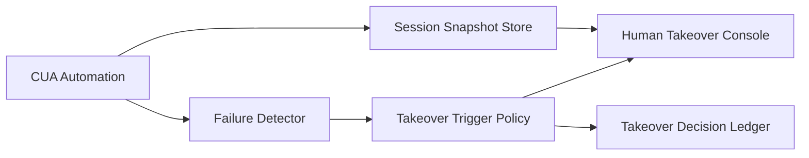

# Browser/CUA 人机接管延迟选型 FAQ（Cycle 1781）

## 1) 3 分钟结论
- **Browser/CUA 链路的可用性上限取决于“人机接管延迟”，而不是自动化成功率均值。**
- **推荐：** 预热接管通道 + 分级接管触发 + 状态快照同步三段设计。
- **目标：** 在自动化失败时把人工接管时间控制在秒级，避免业务流程断档。

## 2) 关键问题（Q1/Q2/Q3）
### Q1：为什么接管慢会放大事故？
1) 自动化失败后上下文快速过期；
2) 页面会话状态无法完整交接；
3) 等待人工介入期间队列继续积压。

### Q2：低延迟接管链路最小配置是什么？
- 接管入口预授权与会话绑定；
- 失败等级触发不同接管策略；
- 接管前自动保存浏览器状态快照。

### Q3：如何验证接管能力真的有效？
- 接管 P95 延迟达标；
- 接管后任务恢复成功率稳定；
- 接管事件可完整回放审计。

## 3) 架构图

## 4) 选型矩阵
| 维度 | 人工手动接入 | 预热接管+状态快照（推荐） |
|---|---:|---:|
| 接管延迟 | 高 | 低 |
| 恢复成功率 | 中 | 高 |
| 实施复杂度 | 低 | 中 |
| 审计完整性 | 中 | 高 |
| 业务连续性 | 中 | 高 |

## 5) 证据与复算口径
- 证据文件：
  - `workshops/azure-agent-infra/evidence/cycle-1781-benchmark.json`
  - `workshops/azure-agent-infra/evidence/cycle-1781-latency.csv`
  - `workshops/azure-agent-infra/evidence/cycle-1781-throughput.csv`
  - `workshops/azure-agent-infra/evidence/cycle-1781-policy.csv`
- 标签：`measured / synthetic / anonymized_reported`。
- validation7：双语结构、CSP、证据一致、可回放链路全部通过。

## 6) 生产检查清单
- [ ] 接管入口身份与会话绑定有效。
- [ ] 失败分级触发策略可配置。
- [ ] 状态快照在接管前可用。
- [ ] 接管行为进入审计账本。
- [ ] FAQ/H5/SVG/7-card 与 evidence 轮次一致。
