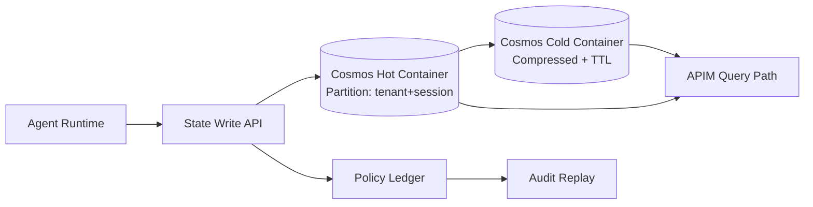

# Cosmos DB Agent State Partitioning and RU Cost Selection FAQ (Cycle 1758)

## 1) Three-minute decision
- **Poor partition-key choices in multi-turn agent state directly amplify cross-partition query RU cost and hotspots.**
- **Recommended order:** decide tenant+session partitioning first, then TTL tiering and index trimming.
- **Goal:** keep p95 query latency and RU/session within budget without losing replayability.

## 2) Core questions (Q1/Q2/Q3)
### Q1: Should we partition by tenant, session, or tool type?
Prefer `tenant_id + session_id` first because it:
1) aligns with read/write locality,
2) supports tenant-level quota and billing,
3) reduces cross-tenant hotspot interference.

### Q2: Where does RU usually explode?
1) excessive cross-partition aggregations,
2) wide indexing on write-heavy payloads,
3) no hot/cold state tiering for long-tail history.

### Q3: How do we keep audit retention and cost control together?
- Keep short-window high-frequency state in hot containers,
- Move long-tail history to compressed cold containers with TTL,
- Reconstruct critical replay paths via policy ledger links.

## 3) Reference architecture

## 4) Decision matrix
| Dimension | Coarse single-partition writes | Tenant+session partition + hot/cold tiering (Recommended) |
|---|---:|---:|
| Write simplicity | High | Medium |
| Cross-partition query cost | High | Low |
| Hotspot risk | High | Medium-low |
| Audit replay clarity | Medium | High |
| Long-term RU control | Low | High |

## 5) Evidence and reproducibility
- Evidence files:
  - `workshops/azure-agent-infra/evidence/cycle-1758-benchmark.json`
  - `workshops/azure-agent-infra/evidence/cycle-1758-latency.csv`
  - `workshops/azure-agent-infra/evidence/cycle-1758-throughput.csv`
  - `workshops/azure-agent-infra/evidence/cycle-1758-policy.csv`
  - `workshops/azure-agent-infra/evidence/cycle-1758-cost.csv`
- Labels: `measured / synthetic / anonymized_reported`.
- This round target: validation7=7/7 with structure, evidence, CSP, bilingual integrity, and cycle consistency checks.

## 6) Production checklist
- [ ] Stress-test hot-container partition strategy against real access paths.
- [ ] Validate cold-container TTL and index trimming policies.
- [ ] Emit tenant-level RU budget alarms with action thresholds.
- [ ] Ensure policy-ledger replay links reconstruct key state transitions.
- [ ] Keep FAQ/H5/SVG/7-card cycle references aligned with evidence.
