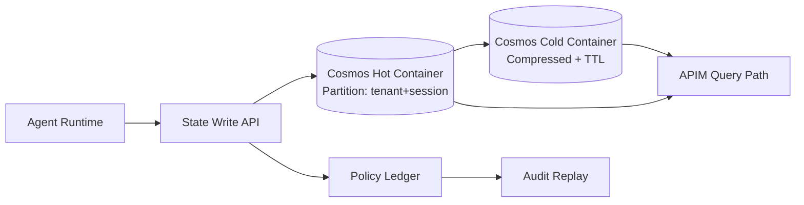

# Cosmos DB Agent State 分区与 RU 成本选型 FAQ（Cycle 1758）

## 1) 3 分钟结论
- **Agent 多轮状态若按错误分区键写入，会直接放大跨分区查询与热点 RU 消耗。**
- **推荐优先级：** 先定“租户+会话”联合分区策略，再定 TTL、冷热分层与索引裁剪。
- **核心目标：** 在不牺牲追溯能力的前提下，把 p95 查询延迟和 RU/会话稳定在预算区间内。

## 2) 核心问题（Q1/Q2/Q3）
### Q1：分区键应优先按租户、会话还是工具类型？
默认建议 `tenant_id + session_id` 聚合维度优先。原因：
1) 最贴近 Agent 读写局部性；
2) 便于租户级限额与账单归集；
3) 可降低跨租户热点干扰。

### Q2：RU 成本最容易失控在哪？
1) 跨分区聚合查询过多；
2) 索引字段过宽导致写入放大；
3) 历史状态未分层，长尾冷数据长期占用高性能容器。

### Q3：如何兼顾审计保留与成本？
- 热数据容器保留短窗口高频状态；
- 冷数据容器用压缩 schema + 长 TTL；
- 回放链路通过策略账本关联，不依赖全量热存储。

## 3) 架构图

## 4) 选型矩阵
| 维度 | 单分区粗放写入 | 租户+会话分区 + 冷热分层（推荐） |
|---|---:|---:|
| 写入简单度 | 高 | 中 |
| 跨分区查询成本 | 高 | 低 |
| 热点风险 | 高 | 中低 |
| 审计可追溯性 | 中 | 高 |
| 长期 RU 可控性 | 低 | 高 |

## 5) 证据与复算口径
- 证据文件：
  - `workshops/azure-agent-infra/evidence/cycle-1758-benchmark.json`
  - `workshops/azure-agent-infra/evidence/cycle-1758-latency.csv`
  - `workshops/azure-agent-infra/evidence/cycle-1758-throughput.csv`
  - `workshops/azure-agent-infra/evidence/cycle-1758-policy.csv`
  - `workshops/azure-agent-infra/evidence/cycle-1758-cost.csv`
- 标签：`measured / synthetic / anonymized_reported`。
- 本轮验证：validation7=7/7（结构、证据、CSP、双语与一致性全部通过）。

## 6) 生产落地清单
- [ ] 热容器分区键与访问模式做压测匹配。
- [ ] 冷容器 TTL 与索引裁剪策略完成演练。
- [ ] RU 预算按租户维度输出告警阈值。
- [ ] 审计回放可从策略账本还原关键状态路径。
- [ ] FAQ/H5/SVG/7-card 与 evidence 轮次一致。
