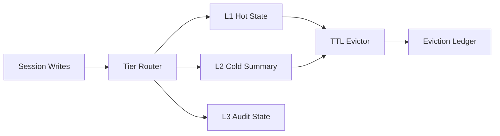

# Cosmos Session State Tiering and TTL Eviction Selection FAQ (Cycle 1772)

## 1) Three-minute decision
- **Session-state cost blowups are usually caused by missing hot/cold tiering and coarse TTL policy.**
- **Recommendation:** short-TTL hot state, longer-TTL cold summaries, and independent retention for audit state.
- **Goal:** preserve multi-turn context usefulness while stabilizing RU and storage growth.

## 2) Core questions (Q1/Q2/Q3)
### Q1: Why does a single TTL policy fail?
1) hot and archival sessions have different lifecycles,
2) one TTL can evict hot state too early or retain cold state too long,
3) audit fields often have separate retention requirements.

### Q2: What is the minimal tiering model?
- L1 hot state: short TTL/high access,
- L2 cold summary: long TTL/low access,
- L3 audit state: compliance retention with independent eviction.

### Q3: How to validate effectiveness?
- lower RU peak volatility,
- acceptable cold-read and restore latency,
- intact audit chain after eviction.

## 3) Reference architecture

## 4) Decision matrix
| Dimension | Single TTL | Tiered TTL + independent audit retention (Recommended) |
|---|---:|---:|
| RU cost control | Low | High |
| Session restore quality | Medium | High |
| Compliance fitness | Medium | High |
| Policy complexity | Low | Medium |
| Ops explainability | Medium | High |

## 5) Evidence and reproducibility
- Evidence files:
  - `workshops/azure-agent-infra/evidence/cycle-1772-benchmark.json`
  - `workshops/azure-agent-infra/evidence/cycle-1772-latency.csv`
  - `workshops/azure-agent-infra/evidence/cycle-1772-throughput.csv`
  - `workshops/azure-agent-infra/evidence/cycle-1772-cost.csv`
- Labels: `measured / synthetic / anonymized_reported`.
- validation7 requires bilingual structure, CSP self-contained cards, evidence consistency, and reproducibility trace.

## 6) Production checklist
- [ ] Tiering rules and keyspace mapping are explicit.
- [ ] TTL policy supports per-tier canary tuning.
- [ ] Audit-state retention/eviction is independent.
- [ ] Eviction decisions are replayable in audit ledger.
- [ ] FAQ/H5/SVG/7-card references are cycle-aligned.
