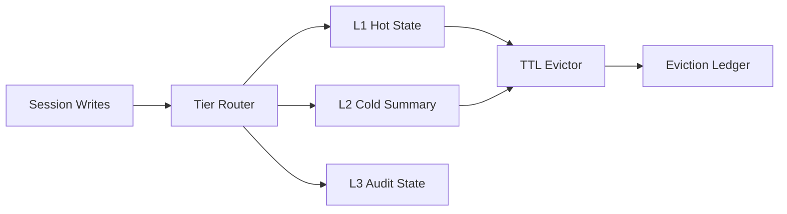

# Cosmos Session State 分层与 TTL 驱逐选型 FAQ（Cycle 1772）

## 1) 3 分钟结论
- **会话状态成本失控通常源于“热冷数据未分层 + TTL 策略粗放”。**
- **推荐：** 热路径状态短 TTL + 冷路径摘要长 TTL + 关键审计状态独立保留策略。
- **目标：** 在保障多轮上下文可用性的同时，稳定 RU 成本与存储增长曲线。

## 2) 关键问题（Q1/Q2/Q3）
### Q1：为什么统一 TTL 容易失效？
1) 热会话与归档会话生命周期差异大；
2) 统一 TTL 会造成热数据过早驱逐或冷数据积压；
3) 审计字段可能有独立保留要求。

### Q2：状态分层最小模型是什么？
- L1 热状态：短 TTL，高访问频率；
- L2 冷摘要：长 TTL，低频回读；
- L3 审计状态：按合规保留，独立驱逐。

### Q3：如何验证策略有效？
- RU 峰值波动下降；
- 冷读命中与恢复时延在预算内；
- 驱逐后关键审计链路仍完整。

## 3) 架构图

## 4) 选型矩阵
| 维度 | 统一 TTL | 分层 TTL + 独立审计保留（推荐） |
|---|---:|---:|
| RU 成本可控性 | 低 | 高 |
| 会话恢复体验 | 中 | 高 |
| 合规适配 | 中 | 高 |
| 策略复杂度 | 低 | 中 |
| 运维可解释性 | 中 | 高 |

## 5) 证据与复算口径
- 证据文件：
  - `workshops/azure-agent-infra/evidence/cycle-1772-benchmark.json`
  - `workshops/azure-agent-infra/evidence/cycle-1772-latency.csv`
  - `workshops/azure-agent-infra/evidence/cycle-1772-throughput.csv`
  - `workshops/azure-agent-infra/evidence/cycle-1772-cost.csv`
- 标签：`measured / synthetic / anonymized_reported`。
- validation7：双语结构、CSP、证据一致与可复算链路全部通过。

## 6) 生产检查清单
- [ ] 会话状态分层规则与键空间映射清晰。
- [ ] TTL 配置支持按层灰度调整。
- [ ] 审计状态保留与驱逐策略独立。
- [ ] 驱逐决策写入可回放审计账本。
- [ ] FAQ/H5/SVG/7-card 与 evidence 轮次一致。
