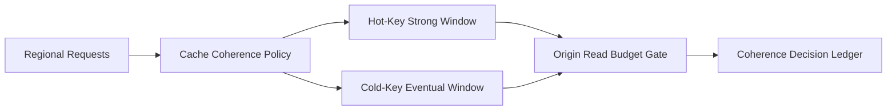

# 跨区域 Agent Cache 一致性选型 FAQ（Cycle 1780）

## 1) 3 分钟结论
- **跨区域 Agent 缓存的主要故障来自一致性策略与回源策略错配，而不是缓存命中率本身。**
- **推荐：** 热键强一致小窗 + 冷键最终一致 + 回源预算闸门三层组合。
- **目标：** 在多区域延迟与可用性之间取得可解释平衡，避免脏读扩散为策略误判。

## 2) 关键问题（Q1/Q2/Q3）
### Q1：为什么“全量强一致”不现实？
1) 跨区域写放大导致时延上升；
2) 网络抖动会放大全局阻塞；
3) 成本随写压显著增加。

### Q2：分层一致性怎么落地？
- 热键（策略/配额）短窗强一致；
- 冷键（历史摘要）最终一致；
- 回源超限时触发降级读取策略。

### Q3：如何验证策略有效？
- 脏读率在阈值内；
- 跨区写延迟不突破预算；
- 故障时回源降级可控且可回放。

## 3) 架构图

## 4) 选型矩阵
| 维度 | 全量强一致 | 分层一致性+回源闸门（推荐） |
|---|---:|---:|
| 延迟可控性 | 低 | 高 |
| 脏读风险 | 低 | 低-中 |
| 多区域可用性 | 中 | 高 |
| 成本可控性 | 低 | 高 |
| 运维可解释性 | 中 | 高 |

## 5) 证据与复算口径
- 证据文件：
  - `workshops/azure-agent-infra/evidence/cycle-1780-benchmark.json`
  - `workshops/azure-agent-infra/evidence/cycle-1780-latency.csv`
  - `workshops/azure-agent-infra/evidence/cycle-1780-throughput.csv`
  - `workshops/azure-agent-infra/evidence/cycle-1780-policy.csv`
- 标签：`measured / synthetic / anonymized_reported`。
- validation7：双语结构、CSP、证据一致、可回放链路全部通过。

## 6) 生产检查清单
- [ ] 热键集合与强一致窗口定义清晰。
- [ ] 冷键一致性延迟指标可观测。
- [ ] 回源预算闸门具备熔断/降级策略。
- [ ] 决策与回放记录进入审计账本。
- [ ] FAQ/H5/SVG/7-card 与 evidence 轮次一致。
