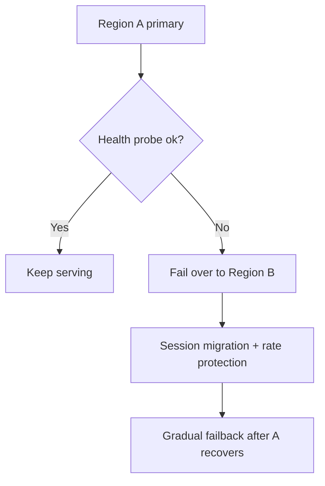
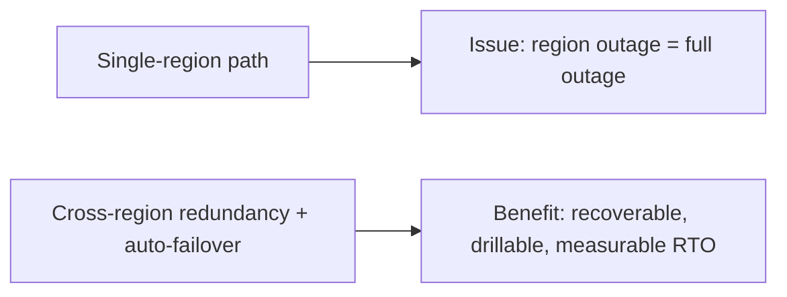
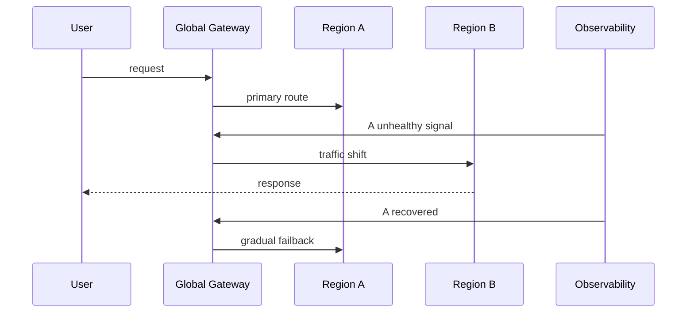

# Cross-region Failover Selection FAQ (Active-Passive vs Active-Active)

> Scope lock: this FAQ focuses only on **cross-region availability and failover architecture for the agent gateway**.

## 1) 📌 Executive Summary (3-minute read)

1. **Production default is Active-Passive with pre-warmed standby** for better cost/control balance.  
2. **Active-Active is preferred only for near-zero-RTO hard requirements**, with much higher consistency/cost pressure.  
3. **Success depends on automated drills and failback policy**, not topology labels.

## 2) 🎯 Hard Questions Q&A

### Q1: When should Active-Passive be primary?

- Seconds-to-minutes failover is acceptable and cost efficiency matters.  
- You want clear primary/standby responsibilities and simpler consistency.

### Q2: When is Active-Active strictly better?

- Global multi-region ingress with near-zero RTO and strict continuity goals.  
- Team can operate dual-write consistency and conflict resolution.

### Q3: What is health-probe + traffic-failback automation?

- **What (plain words)**: continuously test region health, shift traffic on failure, and gradually fail back on recovery.  
- **Pain solved**: manual failover is slow and error-prone.  
- **How**: probe verdict → gateway/DNS weight shift → session reroute → guarded failback.

## 3) 🧭 Visual Explanations (Mermaid)

## 4) 📊 Architect Decision Matrix

| Dimension | Active-Passive | Active-Active |
|---|---|---|
| Cost | Low-medium | High |
| Consistency complexity | Low | High |
| Failover speed | Medium | High |
| Operational complexity | Medium | High |
| Default recommendation | ✅ | Conditional |

## 5) 🧪 Quantitative Example + Benchmark Insight

> Data source: `evidence/cycle-395-benchmark.json`.

| Metric | Active-Passive | Active-Active |
|---|---:|---:|
| Failover RTO p50 | 42s | 9s |
| Failover RTO p95 | 96s | 21s |
| Data consistency conflict rate | 0.2% | 1.8% |
| Monthly baseline cost index | 1.0x | 1.72x |
| Drill success rate | 96.1% | 91.4% |

7-card: `benchmark-cards.html` / `benchmark-cards.en.html`

## 6) 🛠️ Architect Checklist

- [ ] Define RTO/RPO objectives and map to failover policy
- [ ] Implement automated health probes and traffic-weight shift rules
- [ ] Design session migration and idempotent retry handling
- [ ] Run periodic failover/failback drills
- [ ] Build conflict detection/compensation flow for active-active
- [ ] Apply rate-limit and degradation guards during transition
- [ ] Persist failover evidence and postmortem records
