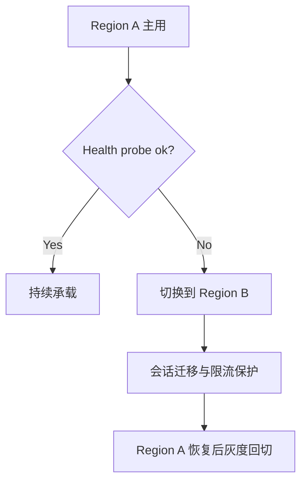
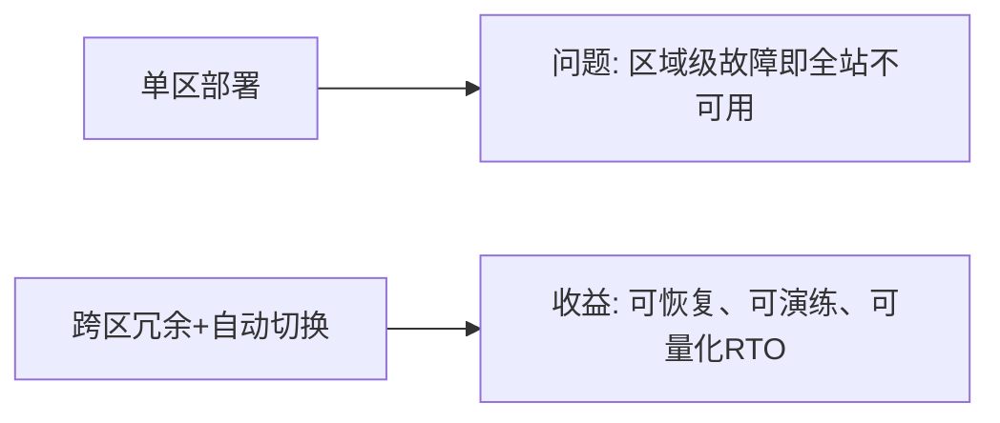
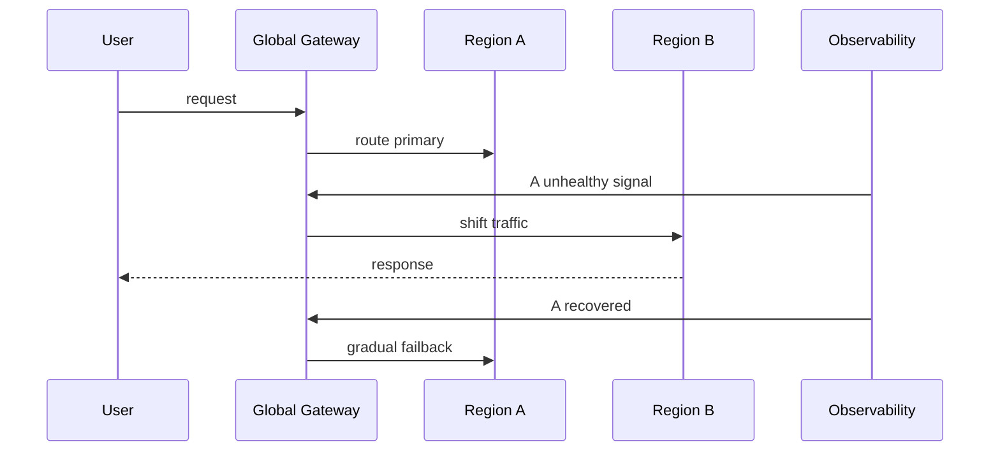

# 跨区域故障切换选型 FAQ（Active-Passive vs Active-Active）

> 专题边界：仅讨论 **Agent Gateway 跨区域可用性与故障切换架构**。

## 1) 📌 Executive Summary（3 分钟结论）

1. **生产默认建议 Active-Passive + 预热热备**：成本更可控，切换路径更可验证。  
2. **Active-Active 仅在超高可用和低RTO硬约束下优先**，但一致性与成本压力显著上升。  
3. **故障切换成败关键是“演练频率与自动化回切策略”而不是拓扑名字。**

## 2) 🎯 灵魂拷问 Q&A

### Q1：什么时候选 Active-Passive？

- 业务可接受秒级到分钟级切换，且更重视成本效率与运维可控。  
- 需要清晰的主备职责和简化一致性模型。

### Q2：什么场景 Active-Active 严格更优？

- 全球多活接入、RTO 接近 0、单区故障不可接受。  
- 团队能够承受双写一致性与冲突治理复杂度。

### Q3：核心技术 X（健康探测+流量回切）是什么，怎么运作？

- **是什么（大白话）**：持续体检每个区域，坏了就自动把流量切到健康区，恢复后再平滑切回。  
- **解决痛点**：手动切换慢且易误操作。  
- **底层运作**：探针判定健康→DNS/网关权重调整→会话路由迁移→回切守护。

## 3) 🧭 可视化图解（Mermaid）

## 4) 📊 Architect Decision Matrix

| 维度 | Active-Passive | Active-Active |
|---|---|---|
| 成本 | 低-中 | 高 |
| 一致性复杂度 | 低 | 高 |
| 切换速度 | 中 | 高 |
| 运维复杂度 | 中 | 高 |
| 默认推荐 | ✅ | 条件适配 |

## 5) 🧪 定量算例 + Benchmark 洞察

> 数据来源：`evidence/cycle-395-benchmark.json`。

| 指标 | Active-Passive | Active-Active |
|---|---:|---:|
| 故障切换 RTO p50 | 42s | 9s |
| 故障切换 RTO p95 | 96s | 21s |
| 数据一致性冲突率 | 0.2% | 1.8% |
| 月度基础成本指数 | 1.0x | 1.72x |
| 演练成功率 | 96.1% | 91.4% |

7-Card：`benchmark-cards.html` / `benchmark-cards.en.html`

## 6) 🛠️ Architect Checklist

- [ ] 明确RTO/RPO目标并映射到切换策略
- [ ] 建立自动健康探测与权重切流规则
- [ ] 设计会话迁移与幂等重试机制
- [ ] 周期性演练故障切换与回切
- [ ] 建立冲突检测与补偿流程（多活）
- [ ] 切换期间启用限流与降级保护
- [ ] 统一记录切换证据与复盘报告
