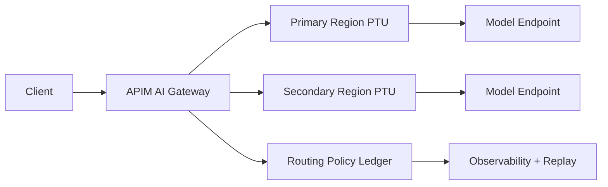

# Cross-Region PTU Overflow and APIM Intelligent Fallback FAQ (Cycle 1756)

## 1) Three-minute decision
- **When primary-region PTU stays above 80% and jitter grows, pre-warm overflow routing instead of waiting for timeout-driven retries.**
- **APIM routing should evaluate three signals together: allocatable PTU, cross-region RTT tier, and recent fallback success rate.**
- **Recommended policy:** primary-first + controlled overflow + fast failback window, with every fallback decision written to a policy ledger.

## 2) Core questions (Q1/Q2/Q3)
### Q1: When should overflow be triggered?
Use a combined gate:
1) PTU utilization above 80% for 3 windows,
2) p95 latency over budget for 2 windows,
3) rising slope in 5xx/429 errors.

### Q2: What should APIM prioritize in routing?
Priority order:
1) **available PTU headroom**,
2) **cross-region RTT tier**,
3) **15-minute fallback success rate**.

### Q3: How do we prevent cost tail after overflow?
Apply a failback window:
- return only after N stable windows in primary,
- run a 5% probe before full failback,
- freeze for 10 minutes if failback fails to avoid oscillation.

## 3) Reference architecture

## 4) Decision matrix
| Dimension | Single-region fixed PTU route | Cross-region PTU + APIM intelligent fallback (Recommended) |
|---|---:|---:|
| Peak resilience | Medium | High |
| Latency stability | Medium | High |
| Cost control | Medium | High (with governance) |
| Ops complexity | Low | Medium-high |
| Recovery speed | Medium | High |

## 5) Evidence and reproducibility
- Evidence files:
  - `workshops/azure-agent-infra/evidence/cycle-1756-benchmark.json`
  - `workshops/azure-agent-infra/evidence/cycle-1756-latency.csv`
  - `workshops/azure-agent-infra/evidence/cycle-1756-throughput.csv`
  - `workshops/azure-agent-infra/evidence/cycle-1756-policy.csv`
- Label contract: `measured / synthetic / anonymized_reported`.
- validation7 checks require latency/throughput/policy/cost consistency, FAQ 6-section shape, CSP validity, and timestamped source metadata.

## 6) Production checklist
- [ ] APIM policy chain includes primary-first, overflow, and failback segments.
- [ ] Policy ledger can replay trigger -> route -> failback outcomes.
- [ ] Critical tenants use explicit canary ratios and allowlists.
- [ ] Drills cover 429 spikes, RTT drift, and failback failures.
- [ ] FAQ / H5 / SVG / 7-card references stay aligned with evidence artifacts.
