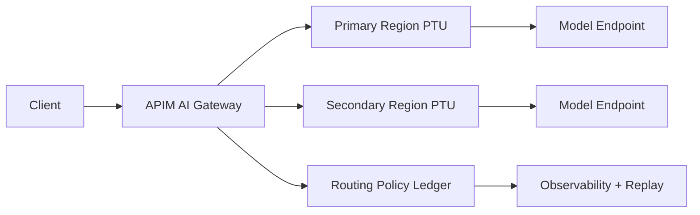

# 跨区 PTU 溢出与 APIM 智能路由回退选型 FAQ（Cycle 1756）

## 1) 3 分钟结论
- **当主区 PTU 达到 80% 以上且请求抖动增大时，应提前进入“跨区溢出预热”而不是等超时后再重试。**
- **APIM 智能路由必须同时看三类信号：模型可用配额、跨区 RTT、策略回退成功率。**
- **推荐策略：** 主区优先 + 溢出灰度 + 失败快速回切（Failback Window），并把每次回退写入策略账本。

## 2) 关键问题（Q1/Q2/Q3）
### Q1：什么时候触发跨区 PTU 溢出最合理？
建议采用“容量 + 延迟 + 错误率”三条件联动：
1) 主区 PTU 利用率连续 3 个窗口 > 80%；
2) p95 延迟连续 2 个窗口超预算；
3) 5xx/429 异常斜率上升。

### Q2：APIM 应该按什么优先级路由？
优先级建议为：
1) **可用 PTU 配额**（防止把请求打到已饱和区域）；
2) **跨区 RTT 档位**（控制用户体感）；
3) **最近 15 分钟回退成功率**（防止抖动区被持续选中）。

### Q3：如何避免“溢出后回不来”的成本拖尾？
使用 Failback Window：
- 仅在主区连续稳定达标 N 个窗口后才回切；
- 回切前先 5% 探针流量验证；
- 回切失败则冻结 10 分钟避免来回抖动。

## 3) 架构图

## 4) 选型矩阵
| 维度 | 单区 PTU 固定路由 | 跨区 PTU + APIM 智能回退（推荐） |
|---|---:|---:|
| 峰值抗压 | 中 | 高 |
| 延迟稳定性 | 中 | 高 |
| 成本可控性 | 中 | 高（需治理） |
| 运维复杂度 | 低 | 中高 |
| 故障恢复速度 | 中 | 高 |

## 5) 证据与可复算口径
- 证据文件：
  - `workshops/azure-agent-infra/evidence/cycle-1756-benchmark.json`
  - `workshops/azure-agent-infra/evidence/cycle-1756-latency.csv`
  - `workshops/azure-agent-infra/evidence/cycle-1756-throughput.csv`
  - `workshops/azure-agent-infra/evidence/cycle-1756-policy.csv`
- 标签口径：`measured / synthetic / anonymized_reported`。
- 本轮 validation7 要求：延迟、吞吐、策略拦截、成本、FAQ 结构、CSP、来源时间戳一致。

## 6) 生产落地清单
- [ ] APIM 路由策略包含主区优先、跨区溢出、失败回切 3 段规则。
- [ ] 策略账本可回放“触发条件 -> 路由决策 -> 回切结果”。
- [ ] 关键租户启用灰度比例与白名单控制。
- [ ] 异常演练覆盖 429 激增、跨区 RTT 抖动、回切失败三类场景。
- [ ] FAQ / H5 / SVG / 7-card 与证据文件引用一致。
