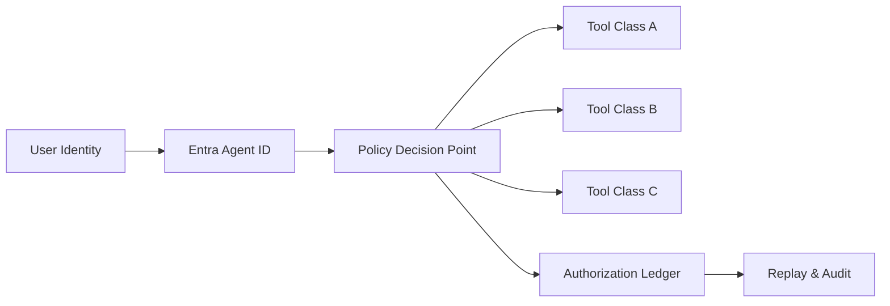

# Entra Agent ID OBO Permission Boundary Selection FAQ (Cycle 1759)

## 1) Three-minute decision
- **In production agent systems, the most critical risk is often OBO authorization boundary drift, not model quality.**
- **Recommended baseline:** separate control-plane identity, execution-plane identity, and tool-access identity; issue least-privilege OBO tokens with short TTL and scoped resources.
- **Outcome goal:** preserve multi-tool usability while enabling explainable denial, replayable authorization, and auditable escalation attempts.

## 2) Core questions (Q1/Q2/Q3)
### Q1: Why does OBO overreach happen in agent flows?
1) multi-hop call chains blur token semantics,
2) proxy layers mix user context and system context,
3) scopes are over-broadened to maximize success rates.

### Q2: How to define executable permission boundaries?
- define tiered scopes by business action,
- enforce second confirmation/human gate for high-risk tools,
- bind each OBO token to tenant + session + tool class tuple.

### Q3: How to prove boundary effectiveness in production?
- log token issuance and denial reasons,
- replay critical sessions for deterministic decisions,
- produce fixed audit reports for escalation drills.

## 3) Reference architecture

## 4) Decision matrix
| Dimension | Coarse global OBO | Tiered least-privilege OBO (Recommended) |
|---|---:|---:|
| Initial complexity | Low | Medium |
| Overreach risk | High | Low |
| Audit explainability | Low | High |
| Incident diagnosis speed | Medium | High |
| Long-term compliance cost | High | Low |

## 5) Evidence and reproducibility
- Evidence files:
  - `workshops/azure-agent-infra/evidence/cycle-1759-benchmark.json`
  - `workshops/azure-agent-infra/evidence/cycle-1759-latency.csv`
  - `workshops/azure-agent-infra/evidence/cycle-1759-policy.csv`
- Labels: `measured / synthetic / anonymized_reported`.
- Validation contract: validation7=7/7 across structure, evidence, bilingual consistency, CSP, and audit-chain integrity.

## 6) Production checklist
- [ ] OBO scopes are least-privilege and policy-versioned per tool class.
- [ ] High-risk tools enforce second confirmation or human review gates.
- [ ] Denial paths are explainable with reason and recovery guidance.
- [ ] Session replay reproduces authorization decisions deterministically.
- [ ] FAQ/H5/SVG/7-card references stay aligned with cycle evidence.
