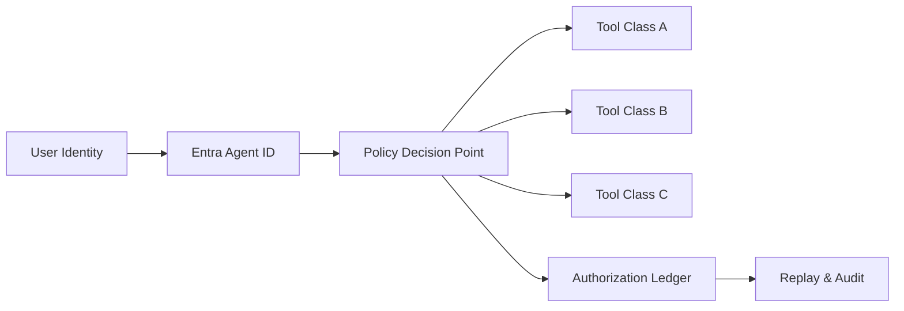

# Entra Agent ID OBO 权限边界选型 FAQ（Cycle 1759）

## 1) 3 分钟结论
- **Agent 系统在生产中最常见高危问题不是模型能力，而是 OBO（On-Behalf-Of）授权边界失控。**
- **推荐原则：** 控制面身份、执行面身份、工具访问身份三分离；OBO Token 只授最小范围、最短时长、最小资源集合。
- **落地目标：** 在保证多工具协同可用的同时，做到“可解释拒绝、可回放授权、可审计越权尝试”。

## 2) 关键问题（Q1/Q2/Q3）
### Q1：为什么 Agent 场景下 OBO 容易越权？
1) 多跳调用链导致 token 语义漂移；
2) 工具代理层把“用户上下文”与“系统上下文”混用；
3) 为追求成功率而过度放宽 scope。

### Q2：如何定义可执行的权限边界？
- 按业务动作分层定义 scope（读/写/管理分离）；
- 对高风险工具启用二次确认或人审阈值；
- 每个 OBO token 绑定租户、会话、工具类别三元组。

### Q3：如何证明边界在生产里真的有效？
- 记录每次 token 签发与拒绝原因；
- 重放关键会话验证“同输入同策略同结果”；
- 对越权演练场景输出固定审计报告。

## 3) 架构图

## 4) 选型矩阵
| 维度 | 粗粒度全局 OBO | 分层最小权限 OBO（推荐） |
|---|---:|---:|
| 上线复杂度 | 低 | 中 |
| 越权风险 | 高 | 低 |
| 审计可解释性 | 低 | 高 |
| 故障定位效率 | 中 | 高 |
| 长期合规成本 | 高 | 低 |

## 5) 证据与复算口径
- 证据文件：
  - `workshops/azure-agent-infra/evidence/cycle-1759-benchmark.json`
  - `workshops/azure-agent-infra/evidence/cycle-1759-latency.csv`
  - `workshops/azure-agent-infra/evidence/cycle-1759-policy.csv`
- 标签：`measured / synthetic / anonymized_reported`。
- 验证约束：validation7=7/7（结构、证据、双语、CSP、审计链一致性）。

## 6) 生产检查清单
- [ ] OBO scope 按工具类别最小化并可追踪到策略版本。
- [ ] 高风险工具有二次确认/人审门槛。
- [ ] 拒绝路径可解释（拒绝原因、责任边界、恢复建议）。
- [ ] 会话回放可复现授权决策结果。
- [ ] FAQ/H5/SVG/7-card 与证据轮次一致。
