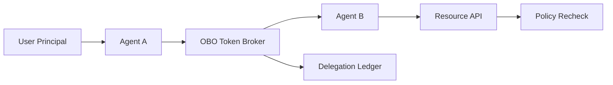

# Entra Agent ID OBO Token Boundary Selection FAQ (Cycle 1773)

## 1) Three-minute decision
- **In multi-agent systems, the main OBO risk is token-boundary spread, not the auth toggle itself.**
- **Recommendation:** least-privilege scopes, single-hop delegation limits, and role-segmented resource authorization.
- **Goal:** enable agent collaboration without cross-role privilege escalation.

## 2) Core questions (Q1/Q2/Q3)
### Q1: Why does OBO fail in production?
1) upstream agents forward over-broad scopes,
2) missing hop-limit allows multi-hop misuse,
3) audit chain omits delegation origin/target.

### Q2: What is the minimum viable boundary set?
- role-bounded scope sets only,
- enforced delegation hop limits,
- downstream resource recheck on caller-agent-id.

### Q3: How to validate boundaries are real?
- overreach paths are consistently denied,
- normal paths keep acceptable latency/success,
- audit trail replays full delegation chains.

## 3) Reference architecture

## 4) Decision matrix
| Dimension | Broad-scope pass-through | Least-scope + single-hop limit (Recommended) |
|---|---:|---:|
| Privilege-escalation risk | High | Low |
| Collaboration usability | Medium | High |
| Implementation complexity | Low | Medium |
| Audit traceability | Low | High |
| Compliance fitness | Medium | High |

## 5) Evidence and reproducibility
- Evidence files:
  - `workshops/azure-agent-infra/evidence/cycle-1773-benchmark.json`
  - `workshops/azure-agent-infra/evidence/cycle-1773-latency.csv`
  - `workshops/azure-agent-infra/evidence/cycle-1773-throughput.csv`
  - `workshops/azure-agent-infra/evidence/cycle-1773-policy.csv`
- Labels: `measured / synthetic / anonymized_reported`.
- validation7 requires bilingual structure, CSP self-contained cards, evidence consistency, and replayability trace.

## 6) Production checklist
- [ ] OBO scope allowlist is role-segmented.
- [ ] Delegation hop-limit policy is enforced.
- [ ] Resource APIs recheck caller-agent-id.
- [ ] Delegation chain is ledgered and replayable.
- [ ] FAQ/H5/SVG/7-card references are cycle-aligned.
