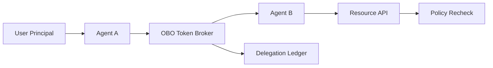

# Entra Agent ID OBO Token 边界选型 FAQ（Cycle 1773）

## 1) 3 分钟结论
- **多代理系统中的 OBO 风险核心是“令牌边界扩散”，不是鉴权开关本身。**
- **推荐：** 令牌最小作用域 + 单跳委托限制 + 资源面按代理角色细分授权。
- **目标：** 让代理可以协作但不能跨越其职责边界访问高权限资源。

## 2) 关键问题（Q1/Q2/Q3）
### Q1：为什么 OBO 在生产中容易出问题？
1) 上游代理把宽作用域令牌传递到下游；
2) 缺少“单跳”限制导致多跳滥用；
3) 审计链未记录委托来源与目标。

### Q2：边界控制的最小可行集是什么？
- 仅允许角色化 scope 集合；
- 强制 OBO 委托次数上限；
- 下游资源对 caller-agent-id 做二次校验。

### Q3：如何验证边界真的收紧了？
- 模拟越权链路必须稳定拒绝；
- 正常链路延迟与成功率保持可接受；
- 审计可回放完整委托路径。

## 3) 架构图

## 4) 选型矩阵
| 维度 | 宽 scope 直传 | 最小 scope + 单跳限制（推荐） |
|---|---:|---:|
| 越权风险 | 高 | 低 |
| 协作可用性 | 中 | 高 |
| 实施复杂度 | 低 | 中 |
| 审计追踪性 | 低 | 高 |
| 合规适配 | 中 | 高 |

## 5) 证据与复算口径
- 证据文件：
  - `workshops/azure-agent-infra/evidence/cycle-1773-benchmark.json`
  - `workshops/azure-agent-infra/evidence/cycle-1773-latency.csv`
  - `workshops/azure-agent-infra/evidence/cycle-1773-throughput.csv`
  - `workshops/azure-agent-infra/evidence/cycle-1773-policy.csv`
- 标签：`measured / synthetic / anonymized_reported`。
- validation7：双语结构、CSP、证据一致、可回放链路全部通过。

## 6) 生产检查清单
- [ ] OBO scope 白名单按代理角色细分。
- [ ] 委托跳数限制策略已生效。
- [ ] 资源面执行 caller-agent-id 二次校验。
- [ ] 委托链路写入审计账本且可回放。
- [ ] FAQ/H5/SVG/7-card 与 evidence 轮次一致。
