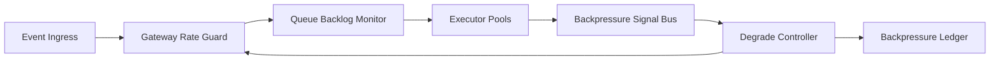

# Event-Driven Agent Backpressure Signal Governance Selection FAQ (Cycle 1771)

## 1) Three-minute decision
- **A frequent collapse mode in event-driven agent platforms is the lack of unified backpressure signaling.**
- **Recommendation:** one protocol across gateway, queues, and executors (rate headroom, backlog depth, failure rates) driving staged load shedding.
- **Goal:** contain local congestion locally and prevent end-to-end timeout storms.

## 2) Core questions (Q1/Q2/Q3)
### Q1: Why queue-length alerts alone are insufficient?
1) backlog lags true throughput degradation,
2) retries can mask congestion,
3) heterogeneous executors distort single-metric interpretation.

### Q2: What should a unified protocol include?
- ingress rate-token headroom,
- backlog/latency thresholds,
- executor failure-rate and degrade state.

### Q3: How to validate effectiveness?
- lower critical timeout rates under peak replay,
- explainable load-shed actions aligned to thresholds,
- non-oscillating recovery behavior.

## 3) Reference architecture

## 4) Decision matrix
| Dimension | Distributed alerts | Unified backpressure protocol (Recommended) |
|---|---:|---:|
| Congestion control | Low | High |
| Path stability | Low | High |
| Debug explainability | Medium | High |
| Implementation complexity | Low | Medium |
| Recovery smoothness | Low | High |

## 5) Evidence and reproducibility
- Evidence files:
  - `workshops/azure-agent-infra/evidence/cycle-1771-benchmark.json`
  - `workshops/azure-agent-infra/evidence/cycle-1771-latency.csv`
  - `workshops/azure-agent-infra/evidence/cycle-1771-throughput.csv`
  - `workshops/azure-agent-infra/evidence/cycle-1771-policy.csv`
- Labels: `measured / synthetic / anonymized_reported`.
- validation7 requires bilingual structure, CSP self-contained cards, evidence consistency, and replayability trace.

## 6) Production checklist
- [ ] Gateway/queue/executor share one backpressure semantics.
- [ ] Degrade thresholds map clearly to signal thresholds.
- [ ] Recovery includes oscillation damping controls.
- [ ] Backpressure decisions are ledgered for audit.
- [ ] FAQ/H5/SVG/7-card references are cycle-aligned.
