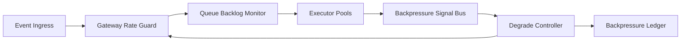

# 事件驱动 Agent 回压信号治理选型 FAQ（Cycle 1771）

## 1) 3 分钟结论
- **事件驱动 Agent 平台在高并发下最常见的崩溃模式是“无统一回压信号”。**
- **推荐：** 网关、队列、执行器统一回压协议（速率、排队深度、失败率）并驱动分级降载。
- **目标：** 将局部拥塞限制在局部，不让其扩散为全链路超时风暴。

## 2) 关键问题（Q1/Q2/Q3）
### Q1：为什么仅靠队列长度告警不够？
1) 队列深度滞后于真实处理能力下降；
2) 失败重试会掩盖真实拥塞；
3) 不同执行器容量差异导致信号失真。

### Q2：统一回压协议应包含什么？
- 入口速率令牌余量；
- 队列延迟与积压阈值；
- 执行器失败率与降级状态。

### Q3：如何验证回压策略有效？
- 峰值流量下关键链路超时率下降；
- 降载行为与信号阈值一致可解释；
- 恢复阶段无反复震荡。

## 3) 架构图

## 4) 选型矩阵
| 维度 | 分散告警 | 统一回压协议（推荐） |
|---|---:|---:|
| 拥塞控制效果 | 低 | 高 |
| 链路稳定性 | 低 | 高 |
| 调试可解释性 | 中 | 高 |
| 实施复杂度 | 低 | 中 |
| 恢复平滑性 | 低 | 高 |

## 5) 证据与复算口径
- 证据文件：
  - `workshops/azure-agent-infra/evidence/cycle-1771-benchmark.json`
  - `workshops/azure-agent-infra/evidence/cycle-1771-latency.csv`
  - `workshops/azure-agent-infra/evidence/cycle-1771-throughput.csv`
  - `workshops/azure-agent-infra/evidence/cycle-1771-policy.csv`
- 标签：`measured / synthetic / anonymized_reported`。
- validation7：双语结构、CSP、证据一致与可复放链路全部通过。

## 6) 生产检查清单
- [ ] 网关/队列/执行器使用同一回压语义。
- [ ] 降级阈值与信号阈值映射清晰。
- [ ] 恢复阶段具备抖动抑制策略。
- [ ] 回压决策写入可审计账本。
- [ ] FAQ/H5/SVG/7-card 与 evidence 轮次一致。
