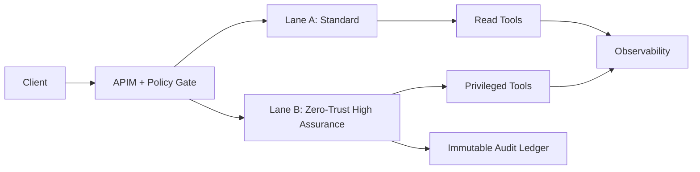

# Financial Zero-Trust Execution Lane Selection FAQ (Cycle 1762)

## 1) Three-minute decision
- **In financial workloads, high-risk agent actions must run in dedicated execution lanes instead of a shared pool.**
- **Recommended model:** standard lane for low-risk interactions, high-assurance lane for privileged operations with strict audit controls.
- **Goal:** maintain business continuity while preserving minimal exposure and replayable compliance evidence.

## 2) Core questions (Q1/Q2/Q3)
### Q1: Why lane grading is necessary?
1) risk tiers require distinct permission boundaries,
2) shared pools let privileged paths inherit weak controls,
3) incident attribution becomes ambiguous.

### Q2: What constraints should the high-assurance lane enforce?
- strict identity and approval chains,
- allowlisted tools with fixed egress,
- immutable audit entries for each execution.

### Q3: How to validate effectiveness?
- overreach requests are consistently denied,
- failover drills preserve audit continuity,
- compare pre/post lane grading on critical success and violation rates.

## 3) Reference architecture

## 4) Decision matrix
| Dimension | Single execution lane | Tiered zero-trust lanes (Recommended) |
|---|---:|---:|
| Implementation complexity | Low | Medium-high |
| Compliance fitness | Low | High |
| Overreach risk | High | Low |
| Audit replay quality | Medium | High |
| Fault isolation | Low | High |

## 5) Evidence and reproducibility
- Evidence files:
  - `workshops/azure-agent-infra/evidence/cycle-1762-benchmark.json`
  - `workshops/azure-agent-infra/evidence/cycle-1762-latency.csv`
  - `workshops/azure-agent-infra/evidence/cycle-1762-policy.csv`
  - `workshops/azure-agent-infra/evidence/cycle-1762-cost.csv`
- Labels: `measured / synthetic / anonymized_reported`.
- validation7 requires bilingual structure, CSP self-containment, evidence consistency, and replayability coverage.

## 6) Production checklist
- [ ] Privileged tools execute only in high-assurance lane.
- [ ] Lane-switch policies include approval and rollback contracts.
- [ ] Audit ledger is immutable and replayable.
- [ ] Overreach drills are part of release gating.
- [ ] FAQ/H5/SVG/7-card references align with cycle evidence.
