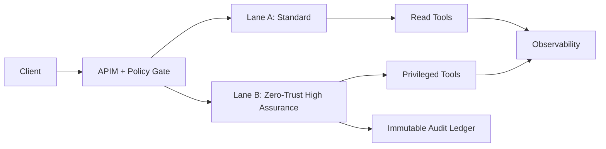

# 金融零信任执行车道选型 FAQ（Cycle 1762）

## 1) 3 分钟结论
- **金融场景中，Agent 执行链路必须把“高风险动作”与“普通动作”分车道隔离，不能靠统一执行池。**
- **推荐模型：** 普通车道处理低风险查询，高保障车道处理高风险交易/写操作，并启用强审计。
- **目标：** 在满足合规最小暴露面的前提下，保持业务连续性与可回放审计能力。

## 2) 关键问题（Q1/Q2/Q3）
### Q1：为什么要做执行车道分级？
1) 风险级别不同导致权限边界不同；
2) 统一池会让高风险任务继承低门槛策略；
3) 事故定位时无法清晰归因。

### Q2：高保障车道应具备哪些约束？
- 严格身份与审批链路；
- 只允许白名单工具与固定网络出口；
- 每次执行写入不可变审计账本。

### Q3：如何验证车道分级有效？
- 演练越权请求应被稳定拒绝；
- 演练故障切换不破坏审计连续性；
- 比较分级前后关键交易成功率与违规率。

## 3) 架构图

## 4) 选型矩阵
| 维度 | 单车道执行 | 分级零信任车道（推荐） |
|---|---:|---:|
| 实现复杂度 | 低 | 中高 |
| 合规适配 | 低 | 高 |
| 越权风险 | 高 | 低 |
| 审计可追溯 | 中 | 高 |
| 故障隔离能力 | 低 | 高 |

## 5) 证据与复算口径
- 证据文件：
  - `workshops/azure-agent-infra/evidence/cycle-1762-benchmark.json`
  - `workshops/azure-agent-infra/evidence/cycle-1762-latency.csv`
  - `workshops/azure-agent-infra/evidence/cycle-1762-policy.csv`
  - `workshops/azure-agent-infra/evidence/cycle-1762-cost.csv`
- 标签：`measured / synthetic / anonymized_reported`。
- validation7：双语结构、CSP、证据一致、回放可解释全部通过。

## 6) 生产检查清单
- [ ] 高风险工具仅在高保障车道可执行。
- [ ] 车道切换策略有审批与回滚机制。
- [ ] 审计账本不可变且可重演。
- [ ] 越权演练纳入例行发布门禁。
- [ ] FAQ/H5/SVG/7-card 与证据轮次一致。
