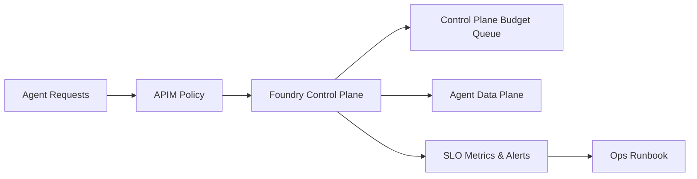

# Foundry Agent Service Control Plane SLO Selection FAQ (Cycle 1763)

## 1) Three-minute decision
- **In Foundry Agent Service production setups, the dominant bottleneck is often control-plane quota and orchestration behavior, not single model invocation latency.**
- **Recommendation:** enforce control-plane budgets (QPS/concurrency/retry caps) with explicit SLO tiers.
- **Goal:** prevent control-plane cascades from turning into tenant-wide service degradation.

## 2) Core questions (Q1/Q2/Q3)
### Q1: Why a separate control-plane SLO?
1) control-plane outages impact session lifecycle globally,
2) healthy data plane does not guarantee orchestration availability,
3) no dedicated signals means slow fault-domain detection.

### Q2: What is the minimum viable SLO package?
- availability targets for control-plane APIs,
- P95 latency targets for lifecycle endpoints,
- recovery budget after quota saturation.

### Q3: What is first when budget is exceeded?
- protect critical tenant paths,
- degrade non-critical automations,
- enforce queue and retry ceilings.

## 3) Reference architecture

## 4) Decision matrix
| Dimension | No dedicated control-plane governance | Control-plane budgets + SLO (Recommended) |
|---|---:|---:|
| Shared-platform stability | Low | High |
| Incident triage speed | Low | High |
| Multi-tenant fairness | Low | High |
| Implementation complexity | Low | Medium |
| Recovery predictability | Low | High |

## 5) Evidence and reproducibility
- Evidence files:
  - `workshops/azure-agent-infra/evidence/cycle-1763-benchmark.json`
  - `workshops/azure-agent-infra/evidence/cycle-1763-latency.csv`
  - `workshops/azure-agent-infra/evidence/cycle-1763-throughput.csv`
  - `workshops/azure-agent-infra/evidence/cycle-1763-cost.csv`
- Labels: `measured / synthetic / anonymized_reported`.
- validation7 requires bilingual structure, CSP self-contained cards, evidence consistency, and replayability notes.

## 6) Production checklist
- [ ] Control-plane and data-plane SLOs are separated.
- [ ] Control-plane retries and concurrency budgets are capped.
- [ ] Tenant priorities map into control-plane budget queues.
- [ ] Over-budget degradation paths are drilled and replayable.
- [ ] FAQ/H5/SVG/7-card references are cycle-aligned.
