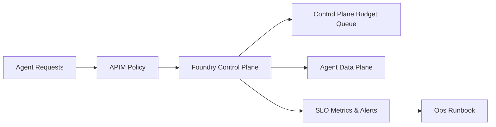

# Foundry Agent Service 控制面 SLO 选型 FAQ（Cycle 1763）

## 1) 3 分钟结论
- **Foundry Agent Service 的生产瓶颈常出现在控制面配额与编排路径，而非单次模型调用。**
- **推荐：** 对控制面请求建立预算（QPS/并发/重试）与分层 SLO（可用性、时延、恢复时间）。
- **目标：** 在多团队共享平台下，避免控制面雪崩导致业务级大面积降级。

## 2) 关键问题（Q1/Q2/Q3）
### Q1：为什么控制面要独立 SLO？
1) 控制面故障会放大到所有会话生命周期；
2) 数据面健康不代表编排可用；
3) 无独立指标时无法快速判定故障域。

### Q2：最小可落地 SLO 该怎么定？
- 可用性：控制面 API 成功率目标；
- 时延：关键生命周期接口 P95 目标；
- 恢复：配额打满后的恢复时间预算。

### Q3：超预算时先做什么？
- 先保护关键租户路径；
- 降级非关键自动化动作；
- 启用控制面排队与重试上限。

## 3) 架构图

## 4) 选型矩阵
| 维度 | 无独立控制面治理 | 控制面预算+SLO（推荐） |
|---|---:|---:|
| 平台共享稳定性 | 低 | 高 |
| 事故定位速度 | 低 | 高 |
| 多租户公平性 | 低 | 高 |
| 落地复杂度 | 低 | 中 |
| 恢复可预测性 | 低 | 高 |

## 5) 证据与复算口径
- 证据文件：
  - `workshops/azure-agent-infra/evidence/cycle-1763-benchmark.json`
  - `workshops/azure-agent-infra/evidence/cycle-1763-latency.csv`
  - `workshops/azure-agent-infra/evidence/cycle-1763-throughput.csv`
  - `workshops/azure-agent-infra/evidence/cycle-1763-cost.csv`
- 标签：`measured / synthetic / anonymized_reported`。
- validation7：双语结构、CSP、证据一致、可回放说明通过。

## 6) 生产检查清单
- [ ] 控制面 SLO 与数据面 SLO 已分离。
- [ ] 控制面重试与并发预算有上限。
- [ ] 租户优先级映射到控制面预算队列。
- [ ] 超预算降级路径已演练并可回放。
- [ ] FAQ/H5/SVG/7-card 与 evidence 轮次一致。
