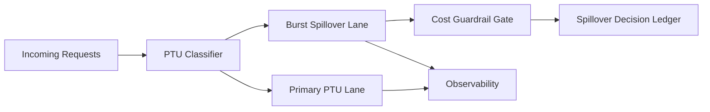

# Foundry PTU Burst Spillover Control Selection FAQ (Cycle 1774)

## 1) Three-minute decision
- **PTU stability is decided by burst spillover control at peak windows, not average utilization.**
- **Recommendation:** primary PTU lane + spillover burst lane + cost-threshold gate.
- **Goal:** preserve critical-path reachability at peaks without allowing spend runaway.

## 2) Core questions (Q1/Q2/Q3)
### Q1: Why PTU can still timeout even with apparent quota?
1) peak arrival outruns scheduler convergence,
2) retry storms amplify same-window load,
3) no spillover priority policy starves critical requests.

### Q2: What is the minimal control architecture?
- primary PTU for baseline demand,
- burst spillover lane for short spikes,
- cost gate for automatic non-critical degradation.

### Q3: How to validate effectiveness?
- critical success improves under peak replay,
- spillover latency stays within budget,
- cost curve stops scaling linearly with bursts.

## 3) Reference architecture

## 4) Decision matrix
| Dimension | Single PTU lane | PTU + spillover + cost gate (Recommended) |
|---|---:|---:|
| Peak stability | Low | High |
| Critical-path assurance | Medium | High |
| Cost control | Low | High |
| Ops complexity | Low | Medium |
| Failure explainability | Medium | High |

## 5) Evidence and reproducibility
- Evidence files:
  - `workshops/azure-agent-infra/evidence/cycle-1774-benchmark.json`
  - `workshops/azure-agent-infra/evidence/cycle-1774-latency.csv`
  - `workshops/azure-agent-infra/evidence/cycle-1774-throughput.csv`
  - `workshops/azure-agent-infra/evidence/cycle-1774-cost.csv`
- Labels: `measured / synthetic / anonymized_reported`.
- validation7 requires bilingual structure, CSP self-contained cards, evidence consistency, and replayability trace.

## 6) Production checklist
- [ ] Primary/spillover lane switching thresholds are explicit.
- [ ] Spillover request prioritization is configurable.
- [ ] Cost-gate degradations have rollback paths.
- [ ] Spillover decisions/results are ledgered.
- [ ] FAQ/H5/SVG/7-card references are cycle-aligned.
