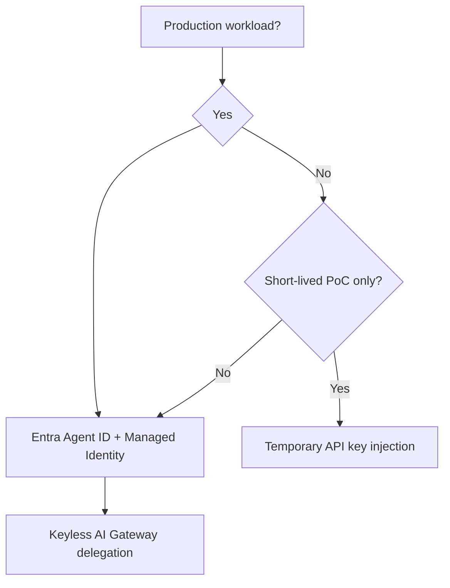
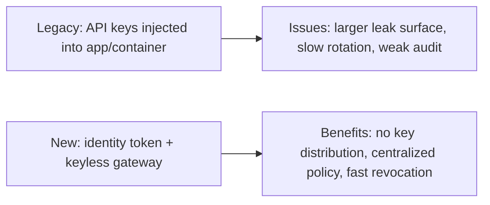
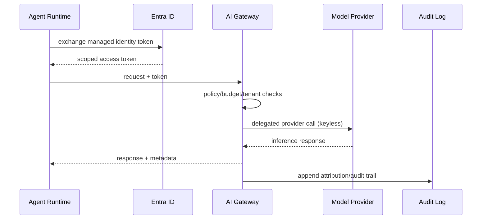

# Agent Identity & Credential Governance Selection FAQ (Entra Agent ID + Managed Identity vs API Key Injection)

> Scope lock: this FAQ focuses only on **identity and credential governance architecture**, not runtime/sandbox selection.

## 1) 📌 Executive Summary (3-minute read)

1. **Production default should be Entra Agent ID + Managed Identity + keyless gateway delegation** to avoid distributing raw secrets.  
2. **API key injection is acceptable only for short-lived PoC**; in production it amplifies leak/rotation/audit risk.  
3. **First priority is revocability, traceability, and least privilege**, not “ship first, secure later.”

## 2) 🎯 Hard Questions Q&A

### Q1: When is Entra Agent ID + Managed Identity mandatory?

- Multi-tenant SaaS and regulated workloads that require unified attribution and rapid credential revocation.  
- You need one traceable chain from agent action to tenant identity and policy decision.

### Q2: When is API key injection strictly better?

- Only for short PoC/local experiments that are explicitly excluded from production paths.  
- Teams without immediate identity platform integration but with a committed near-term migration plan.

### Q3: What is keyless gateway delegation, what pain does it solve, and how does it work?

- **What (plain words)**: agents send identity proof, not provider keys; gateway calls model/tool endpoints on their behalf.  
- **Pain solved**: keys scattered across env vars, images, scripts, and logs are hard to rotate and audit.  
- **How**:
  - Agent exchanges managed identity for a scoped Entra token.
  - Token is validated by AI Gateway for tenant/policy/quota controls.
  - Gateway delegates provider calls and logs full attribution.

## 3) 🧭 Visual Explanations (Mermaid)

## 4) 📊 Architect Decision Matrix

| Dimension | Entra + Managed Identity + Keyless | API Key Injection |
|---|---|---|
| Secret exposure surface | Very low | High |
| Least-privilege enforcement | Strong | Weak |
| Revocation/rotation speed | High | Low |
| Attribution & audit quality | Strong | Medium-to-weak |
| Initial integration effort | Medium | Low |
| Production recommendation | ✅ Default | ❌ PoC only |

## 5) 🧪 Quantitative Example + Benchmark Insight

> Data source: `evidence/cycle-390-benchmark.json` (sealed evidence with measured/synthetic/anonymized_reported labels).

| Metric | Keyless identity path | API key injection | Insight |
|---|---:|---:|---|
| Credential exposure events (per 100k sessions) | 0.8 | 19.6 | decisive difference is whether keys are distributed |
| Revocation effectiveness p50 | 35s | 21min | identity-plane revocation drastically narrows risk window |
| Attribution completeness | 99.2% | 76.4% | keyless path improves end-to-end accountability |
| Added p50 request latency | +9ms | +0ms | acceptable overhead for high-governance workloads |
| Governance cost per session (20 min) | $0.0056 | $0.0049 | extra cost buys compliance and control |

7-card (4:5, CSP self-contained): `benchmark-cards.html` / `benchmark-cards.en.html`

## 6) 🛠️ Architect Checklist

- [ ] Prohibit long-lived API keys in sandbox/container environment variables  
- [ ] Maintain Entra Agent ID mapping ledger by tenant/team/workload  
- [ ] Enforce keyless delegation through AI Gateway for all provider calls  
- [ ] Gate releases with revocation latency and attribution completeness SLOs  
- [ ] Drill secret-compromise response and rapid credential recovery playbooks  
- [ ] Require human confirmation for high-risk tool invocation classes  
- [ ] Audit least-privilege boundaries and policy drift weekly  
