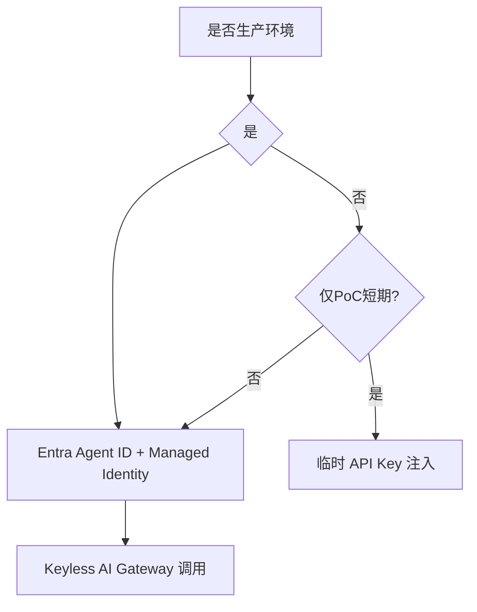
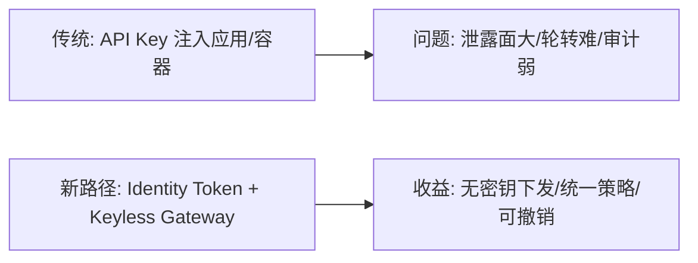
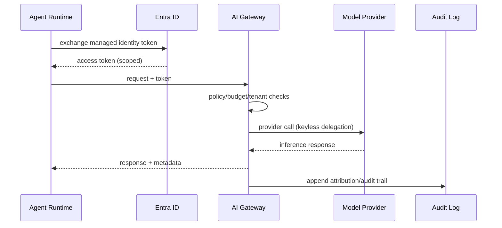

# Agent 身份与凭据治理选型 FAQ（Entra Agent ID + Managed Identity vs API Key 注入）

> 专题边界：仅讨论 **Agent 身份与凭据治理架构**，不展开 Runtime/Sandbox 选型。

## 1) 📌 Executive Summary（3 分钟结论）

1. **生产默认应采用“Entra Agent ID + Managed Identity + Keyless Gateway”**，避免明文密钥进入沙箱。  
2. **API Key 注入只适合短期 PoC**：上线后会快速放大泄露、轮转与审计风险。  
3. **身份治理的第一优先级是“可撤销、可审计、可最小授权”**，不是“先跑通再补安全”。

## 2) 🎯 灵魂拷问 Q&A

### Q1：什么时候必须选 Entra Agent ID + Managed Identity？

- 多租户 SaaS、金融/政企高合规、需要统一审计和快速吊销权限的场景。  
- 你需要把 Agent 行为和真实身份、租户、策略绑定到同一条可追溯链路。

### Q2：什么场景 API Key 注入严格更优？

- 仅限“短期演示/本地实验/一次性验证”，且明确不进入生产链路。  
- 团队尚未具备身份平台接入条件，但已计划短期内迁移到 Keyless 架构。

### Q3：核心技术 X（Keyless Gateway）是什么，解决什么痛点，底层怎么运作？

- **是什么（大白话）**：Agent 不直接拿密钥；它拿“身份证明”，网关代它去调用模型/工具。  
- **解决痛点**：密钥散落在环境变量、容器镜像、日志与脚本里，难轮转、难审计、难追责。  
- **底层运作**：
  - Agent 用 Managed Identity 向 Entra 换令牌；
  - 令牌进 AI Gateway 做身份映射、配额与策略检查；
  - 网关代表 Agent 调用下游模型，并记录全链路审计。

## 3) 🧭 可视化图解（Mermaid）

## 4) 📊 Architect Decision Matrix

| 维度 | Entra + Managed Identity + Keyless | API Key 注入 |
|---|---|---|
| 密钥泄露面 | 很低 | 高 |
| 最小权限控制 | 强 | 弱 |
| 吊销/轮转效率 | 高 | 低 |
| 追责与审计 | 强 | 中-弱 |
| 初始接入复杂度 | 中 | 低 |
| 生产推荐 | ✅ 默认 | ❌ 仅PoC |

## 5) 🧪 定量算例 + Benchmark 洞察

> 数据来源：`evidence/cycle-390-benchmark.json`（sealed evidence，标签按 measured/synthetic/anonymized_reported 分层）。

| 指标 | Keyless 身份链路 | API Key 注入 | 洞察 |
|---|---:|---:|---|
| 凭据暴露事件（每10万会话） | 0.8 | 19.6 | 关键差异是“是否下发密钥” |
| 权限撤销生效 p50 | 35s | 21min | 身份平台显著降低撤销窗口 |
| 审计归因完整率 | 99.2% | 76.4% | Keyless 更易实现端到端归因 |
| p50 调用延迟增量 | +9ms | +0ms | 安全收益换来可接受开销 |
| 单会话治理成本（20 分钟） | $0.0056 | $0.0049 | 额外成本换来合规与可控性 |

7-Card（4:5，CSP 自包含）：`benchmark-cards.html` / `benchmark-cards.en.html`

## 6) 🛠️ Architect Checklist

- [ ] 禁止在沙箱/容器环境变量中注入长期 API Key  
- [ ] 建立 Entra Agent ID 与租户/团队的映射台账  
- [ ] 所有下游调用必须经 AI Gateway 完成 keyless 代理  
- [ ] 将吊销时延、审计归因率纳入发布门禁  
- [ ] 制定密钥应急轮转与失陷回收演练流程  
- [ ] 对高风险工具调用启用强制人工确认策略  
- [ ] 每周审计最小权限边界与策略漂移  
