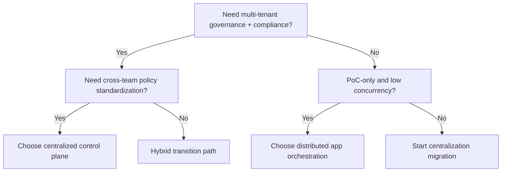
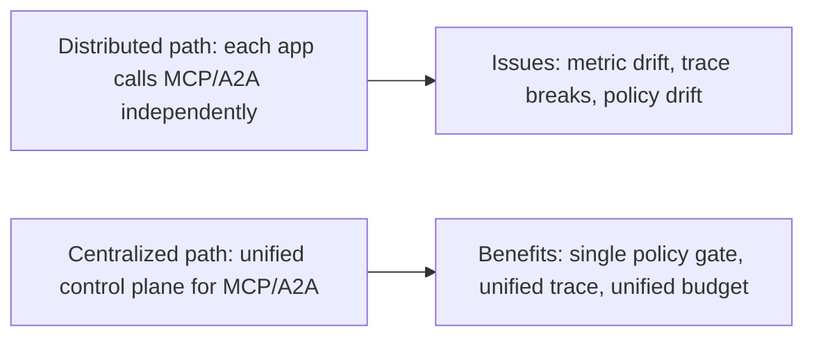
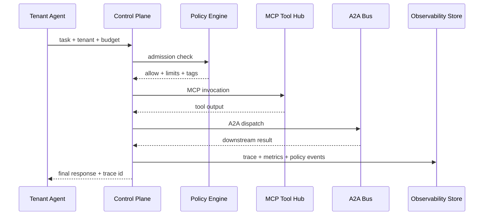

# MCP/A2A Production Orchestration & Observability Selection FAQ (Centralized Control Plane vs App-Embedded Orchestration)

> Scope lock: this document focuses only on **MCP/A2A orchestration and observability architecture selection**.

## 1) 📌 Executive Summary (3-minute read)

1. **For multi-tenant production, centralized orchestration is the default**: policy, budget, tracing, and audit are consistent and controllable.  
2. **App-embedded distributed orchestration is suitable only for low-scale PoC**: fast to ship, but weak in cross-service traceability and policy consistency.  
3. **The architecture inflection point appears when tool count, tenant count, and compliance pressure grow together**: centralized governance becomes mandatory, not optional.

## 2) 🎯 Hard Questions Q&A

### Q1: When should I choose centralized orchestration (A) vs distributed app-level orchestration (B)?

- Choose **A (centralized)** when you need unified token budgets, policy interception, MCP tool permissions, and A2A tracing.  
- Choose **B (distributed)** for short-lived internal PoC with low concurrency and low governance requirements.

### Q2: When is B strictly better?

- Single app, short validation window, low blast radius, and a hard requirement for fastest possible iteration.  
- You explicitly accept future refactoring cost.

### Q3: What is the core mechanism (trace-linked policy graph), what pain does it solve, and how does it work?

- **What**: model/MCP/A2A actions are stitched into one trace graph with policy checkpoints.  
- **Pain solved**: “works in practice but not auditable” and “auditable but not attributable” in distributed agent chains.  
- **How**:  
  - each call gets `trace_id` + `span_id`;  
  - policy engine evaluates tenant/tool/budget/risk labels;  
  - observability plane aggregates latency, throughput, interception, and over-limit events into replayable evidence.

## 3) 🧭 Visual Explanations (Mermaid)

## 4) 📊 Architect Decision Matrix

| Dimension | Centralized Orchestration (Gateway/Control Plane) | Distributed App-Embedded Orchestration |
|---|---|---|
| Policy consistency | Strong | Weak |
| End-to-end observability | Strong (unified trace) | Medium-to-weak |
| Initial delivery speed | Medium | Fast |
| Multi-tenant governance | Strong | Weak |
| Audit attribution | Strong | Weak |
| Long-term evolution cost | Low-to-medium | Medium-to-high |

## 5) 🧪 Quantitative Example + Benchmark Insight

> Data source: `evidence/cycle-384-benchmark.json` (sealed evidence) and corresponding 7-card deck.

| Metric | Centralized path | Distributed path | Insight |
|---|---:|---:|---|
| Orchestration p50 latency | 136ms | 248ms | centralization reduces repeated auth/retry overhead |
| Orchestration p95 latency | 214ms | 410ms | distributed path jitters under peak load |
| A2A throughput p50 | 460 RPS | 320 RPS | unified scheduling reduces hotspot contention |
| Policy interception rate (high-risk calls) | 95%+ | 79% | centralized policy substantially improves coverage |
| Session governance cost (20 min) | $0.0056 | $0.0048 | slightly higher governance cost, lower risk cost |

7-card (4:5, CSP self-contained): `benchmark-cards.html` / `benchmark-cards.en.html`

## 6) 🛠️ Architect Checklist

- [ ] Standardize trace_id/span_id and enforce propagation across all hops  
- [ ] Centralize MCP tool registry, permission scopes, and tenant isolation rules  
- [ ] Standardize A2A message taxonomy, retries, dead-letter policy, and retention  
- [ ] Gate p50/p95 latency, throughput, and interception rate before release  
- [ ] Define over-budget actions (deny/degrade/queue) and alert thresholds  
- [ ] Design control-plane failure fallback (bypass/read-only/static allowlist)  
- [ ] Run weekly false-positive policy review + regression tests  

