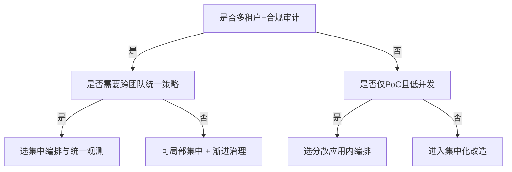
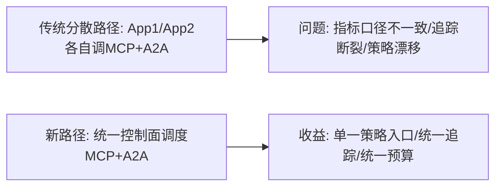
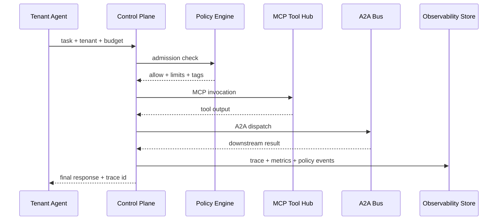

# MCP/A2A 生产编排与可观测性选型 FAQ（集中网关编排 vs 分散应用内编排）

> 专题边界：本文件仅聚焦 **MCP/A2A 在生产环境的编排与可观测性选型**，不扩展到沙盒 runtime 选型。

## 1) 📌 Executive Summary（3 分钟结论）

1. **多租户生产环境默认优先“集中编排（Gateway/Control Plane）”**：统一策略、预算、追踪和审计，故障定位更可控。  
2. **分散应用内编排只适合低并发 PoC 或单团队内测**：上线快，但跨服务链路可观测性和策略一致性最弱。  
3. **架构拐点发生在“工具数量增长 + 租户增多 + 合规审计”同时出现时**：这时统一编排从“优化项”变成“生存项”。

## 2) 🎯 灵魂拷问 Q&A

### Q1：什么时候选集中编排（A）vs 分散编排（B）？

- 选 **A（集中）**：  
  - 需要统一 token 预算、策略拦截、MCP 工具权限、A2A 追踪；  
  - 需要跨团队共享治理标准与审计证据。  
- 选 **B（分散）**：  
  - 仅内部 PoC，工具链短，租户少，允许快速迭代后再重构。

### Q2：什么场景下 B 严格更优？

- 单应用、短周期、低风险验证，目标是 **最短时间验证业务价值**；  
- 未来可接受重构成本，不要求即时形成统一治理面。

### Q3：核心技术 X（Trace-linked policy graph）是什么？解决什么痛点？底层如何运作？

- **是什么**：把 MCP 工具调用、A2A 消息交换、模型请求串成一条可追踪图，并在关键节点执行策略。  
- **解决什么痛点**：分布式 Agent 链路常见“能跑但不可审、可审但不可归因”。  
- **底层怎么运作**：  
  - 每次调用分配 `trace_id` / `span_id`；  
  - 策略引擎按租户、工具、预算、风险标签做准入判定；  
  - 观测面汇总延迟、吞吐、拦截率、超限事件，形成可复盘证据。

## 3) 🧭 可视化图解（Mermaid）

## 4) 📊 Architect Decision Matrix

| 维度 | 集中编排（Gateway/Control Plane） | 分散应用内编排 |
|---|---|---|
| 策略一致性 | 强 | 弱 |
| 链路可观测性 | 强（trace 统一） | 中-弱（常断链） |
| 初始交付速度 | 中 | 快 |
| 多租户治理 | 强 | 弱 |
| 审计可归因 | 强 | 弱 |
| 长期演进成本 | 低-中 | 中-高（后期重构） |

## 5) 🧪 定量算例 + Benchmark 洞察

> 数据来源：`evidence/cycle-384-benchmark.json`（sealed evidence）与对应 7-Card 卡组。

| 指标 | 集中编排路径 | 分散编排路径 | 洞察 |
|---|---:|---:|---|
| 编排链路 p50 延迟 | 136ms | 248ms | 集中化后跨服务重试与重复鉴权下降 |
| 编排链路 p95 延迟 | 214ms | 410ms | 分散路径在峰值更易抖动 |
| A2A 吞吐 p50 | 460 RPS | 320 RPS | 统一调度减少热点冲突 |
| 策略拦截率（高风险调用） | 95%+ | 79% | 统一策略面显著提高拦截覆盖 |
| 单会话治理成本（20 分钟） | $0.0056 | $0.0048 | 集中路径略增治理成本但显著降风险成本 |

7-Card（4:5，CSP 自包含）：`benchmark-cards.html` / `benchmark-cards.en.html`

## 6) 🛠️ Architect Checklist

- [ ] 统一 trace_id/span_id 规范并强制全链路透传  
- [ ] 统一 MCP 工具注册、权限域与租户隔离策略  
- [ ] 统一 A2A 消息分类、重试、死信与审计保留策略  
- [ ] 把 p50/p95 延迟、吞吐、拦截率纳入发布门禁  
- [ ] 定义预算超限动作（拒绝/降级/排队）与告警阈值  
- [ ] 设计“控制面故障”降级策略（旁路、只读、静态白名单）  
- [ ] 建立每周策略误杀复盘与规则回归测试流程  

