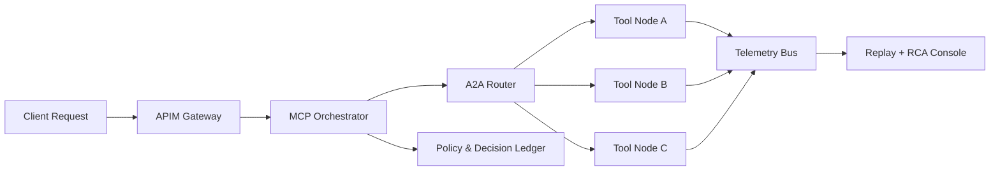

# MCP/A2A Production Observability and Orchestration Selection FAQ (Cycle 1760)

## 1) Three-minute decision
- **In production MCP/A2A systems, the highest risk is not failure itself but non-explainable failures, non-attributable retries, and non-replayable fallback paths.**
- **Recommended baseline:** unified trace IDs, topology-aware tool telemetry, and immutable policy fallback ledger.
- **Goal:** every orchestration decision should answer why it executed, failed, fell back, and whether it is replayable.

## 2) Core questions (Q1/Q2/Q3)
### Q1: What is the minimum observability set for MCP/A2A?
1) request-level trace/span,
2) tool-level I/O summaries (redacted),
3) policy-level decision rationale and version,
4) fallback trigger/recovery windows.

### Q2: Why are typical dashboards still insufficient?
Because success-rate/latency alone miss:
- retry amplification paths,
- cross-agent context loss,
- policy drift that still returns “successful” responses.

### Q3: How do we define operable orchestration SLOs?
- combine end-to-end chain SLO and node-level SLO,
- include explainable-failure-rate as a governance metric,
- validate fallback-alert runbook linkage in drills.

## 3) Observability architecture

## 4) Decision matrix
| Dimension | Basic log stitching | End-to-end orchestration observability (Recommended) |
|---|---:|---:|
| Incident diagnosis speed | Medium | High |
| Policy explainability | Low | High |
| False-alarm control | Low | Medium-high |
| Implementation complexity | Low | Medium |
| Long-run operations efficiency | Medium | High |

## 5) Evidence and reproducibility
- Evidence files:
  - `workshops/azure-agent-infra/evidence/cycle-1760-benchmark.json`
  - `workshops/azure-agent-infra/evidence/cycle-1760-latency.csv`
  - `workshops/azure-agent-infra/evidence/cycle-1760-throughput.csv`
  - `workshops/azure-agent-infra/evidence/cycle-1760-policy.csv`
- Labels: `measured / synthetic / anonymized_reported`.
- validation7 requires structural integrity, evidence alignment, CSP self-containment, and bilingual semantic consistency.

## 6) Production checklist
- [ ] Every MCP/A2A hop carries a consistent trace_id chain.
- [ ] Tool I/O summaries are auditable and redacted.
- [ ] Policy decisions (including fallback) are replayable by version.
- [ ] Alerts are bound to recovery playbooks and ownership domains.
- [ ] FAQ/H5/SVG/7-card references stay aligned with cycle evidence.
