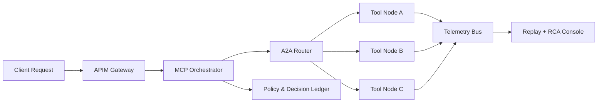

# MCP/A2A 生产编排可观测性选型 FAQ（Cycle 1760）

## 1) 3 分钟结论
- **MCP/A2A 在生产中的首要风险不是调用失败本身，而是“失败不可解释、重试不可归因、回退不可回放”。**
- **推荐做法：** 请求链路统一 Trace ID，工具调用按拓扑分层打点，策略回退写入不可变账本。
- **目标：** 让每次编排决策都能回答“为何执行、为何失败、为何回退、是否可重演”。

## 2) 核心问题（Q1/Q2/Q3）
### Q1：MCP/A2A 观测最小集合是什么？
1) 请求级 Trace/Span；
2) 工具级输入输出摘要（脱敏）；
3) 策略级决策原因与版本；
4) 回退级触发与恢复窗口。

### Q2：为什么常见监控面板仍不足？
因为只看成功率和延迟会漏掉：
- 重试放大路径；
- 跨代理转发导致的上下文丢失；
- “成功但违规”的策略偏差。

### Q3：如何构建可运营的编排 SLO？
- 定义链路 SLO（端到端）+ 节点 SLO（单工具）；
- 把“可解释失败率”纳入治理指标；
- 演练中验证回退策略与告警联动。

## 3) 编排可观测架构

## 4) 选型矩阵
| 维度 | 基础日志拼接 | 端到端编排可观测（推荐） |
|---|---:|---:|
| 故障定位速度 | 中 | 高 |
| 策略可解释性 | 低 | 高 |
| 误报率控制 | 低 | 中高 |
| 实施复杂度 | 低 | 中 |
| 长期运维效率 | 中 | 高 |

## 5) 证据与复算口径
- 证据文件：
  - `workshops/azure-agent-infra/evidence/cycle-1760-benchmark.json`
  - `workshops/azure-agent-infra/evidence/cycle-1760-latency.csv`
  - `workshops/azure-agent-infra/evidence/cycle-1760-throughput.csv`
  - `workshops/azure-agent-infra/evidence/cycle-1760-policy.csv`
- 标签：`measured / synthetic / anonymized_reported`。
- validation7：结构完整、证据一致、CSP 自包含、双语与拓扑语义一致。

## 6) 生产检查清单
- [ ] 所有 MCP/A2A hop 统一 trace_id 与因果链路。
- [ ] 工具摘要可审计且脱敏。
- [ ] 策略决策（含回退）可回放到版本级。
- [ ] 告警阈值绑定恢复手册与责任域。
- [ ] FAQ/H5/SVG/7-card 与 evidence 轮次一致。
