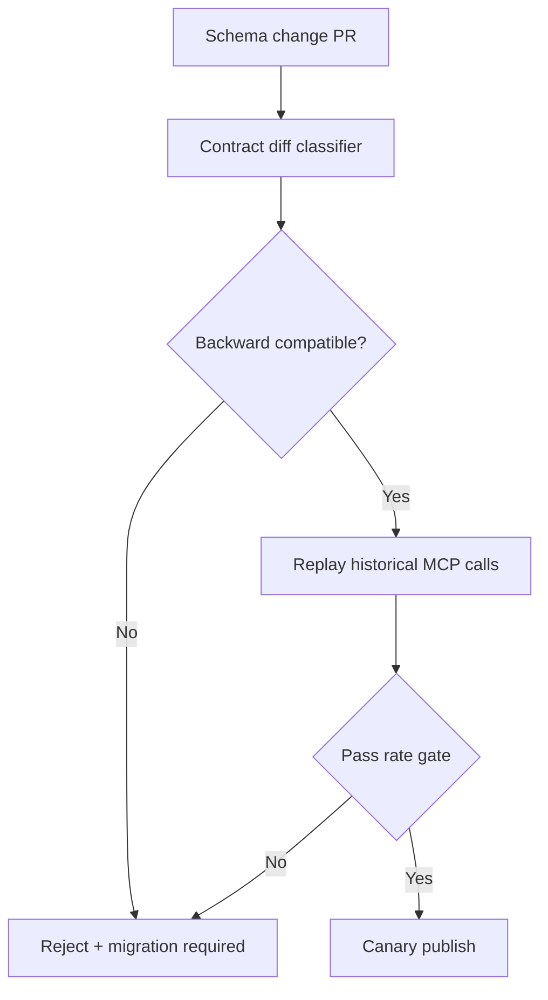
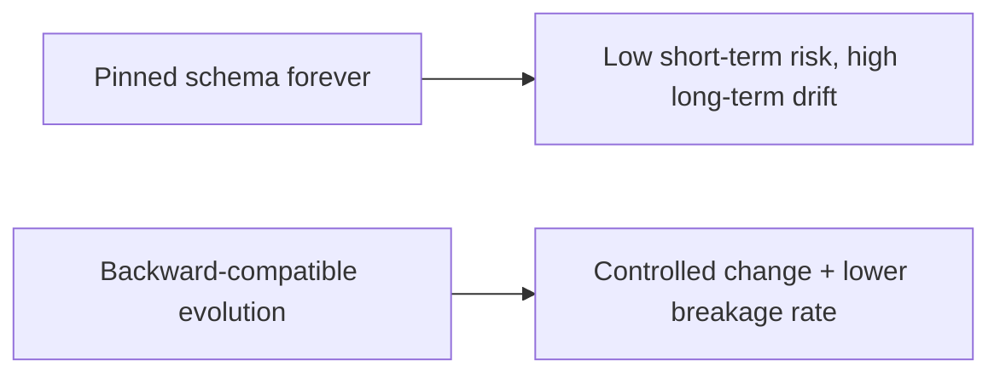
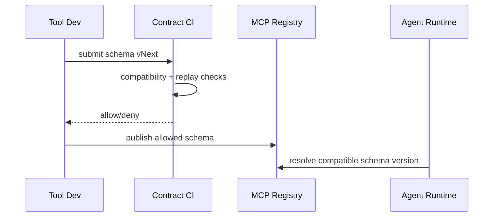

# MCP Schema Governance FAQ (Pinned Contract vs Backward-Compatible Evolution)

> Scope boundary: this FAQ focuses only on **MCP tool schema release and compatibility governance**. It does not expand into identity architecture or sandbox supply-chain topics.

## 1) 📌 Executive Summary (3-minute take)

1. **Default production pattern: backward-compatible schema evolution + contract-test gates**.  
2. **Pinned contracts are useful for short freeze windows**, but become expensive as long-term version forks accumulate.  
3. **Schema governance is about verifiable change, executable rollback, and traceable calls**—not only parse success.

## 2) 🎯 Core Q&A

### Q1: When is a pinned contract acceptable?

- During high-risk freeze windows, compliance audits, or before external consumers finish upgrades.  
- Only with a clear freeze-exit date and migration plan.

### Q2: When is backward-compatible evolution mandatory?

- Multi-tenant SaaS, parallel tool teams, and large consumer fleets with uneven upgrade cadence.  
- Any environment requiring zero-downtime release and progressive rollout.

### Q3: What is the key technique (schema contract gate), and how does it work?

- **Plain words**: every schema change passes a compatibility checkpoint before release.  
- **Problem solved**: prevents sudden runtime failures when agents/tools call older contracts.  
- **Mechanism**: schema diff classification (add/remove/breaking) → compatibility tests → replay validation → allow/deny.

## 3) 🧭 Visual breakdown (Mermaid)

## 4) 📊 Architect Decision Matrix

| Dimension | Pinned contract | Backward-compatible evolution |
|---|---|---|
| Short-term release stability | High | Medium-High |
| Long-term evolution speed | Low | High |
| Compatibility risk control | Medium | High |
| Change governance complexity | Low | Medium |
| Production default | Transitional only | ✅ |

## 5) 🧪 Quantitative example + benchmark insight

> Data source: `evidence/cycle-399-benchmark.json`.

| Metric | Pinned | Backward-compatible evolution |
|---|---:|---:|
| MCP call breakage rate | 7.9% | 1.8% |
| Compatibility replay pass rate | 86.4% | 97.2% |
| Release-window p50 latency jitter | 190 ms | 210 ms |
| Mean rollback duration | 24 min | 9 min |
| Governance cost increment per session | $0.0003 | $0.0008 |

7-Card: `benchmark-cards.html` / `benchmark-cards.en.html`

## 6) 🛠️ Architect checklist

- [ ] Every schema change has compatibility diff classification
- [ ] Breaking changes require migration plan + rollback script
- [ ] Historical MCP call replay is mandatory before publish
- [ ] Registry keeps traceable version timeline
- [ ] Runtime errors are observable by schema version
- [ ] Tenant-batch upgrade and rollback strategy is tested
- [ ] Weekly review of breakage and migration defects
