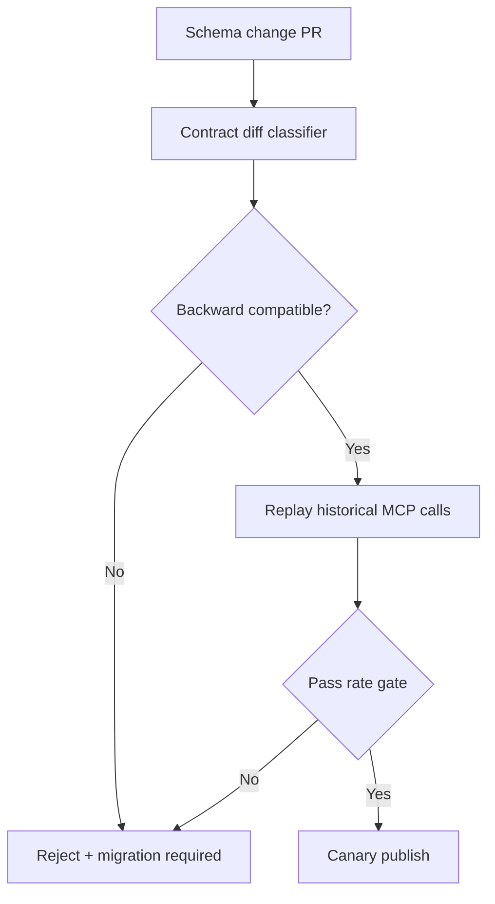
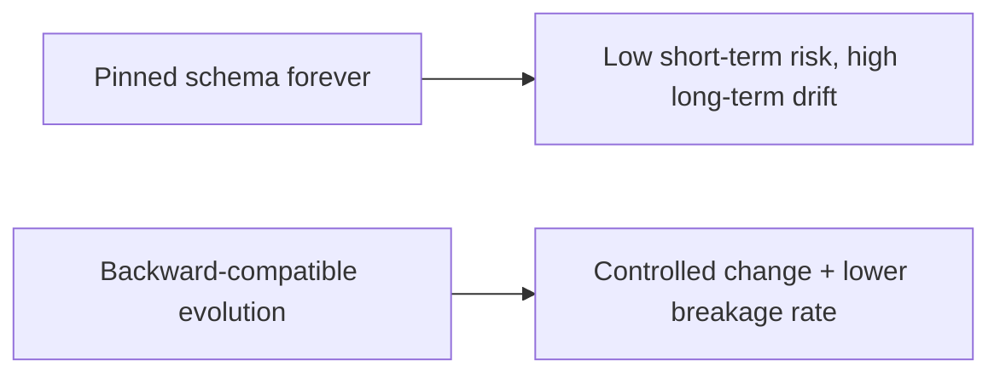
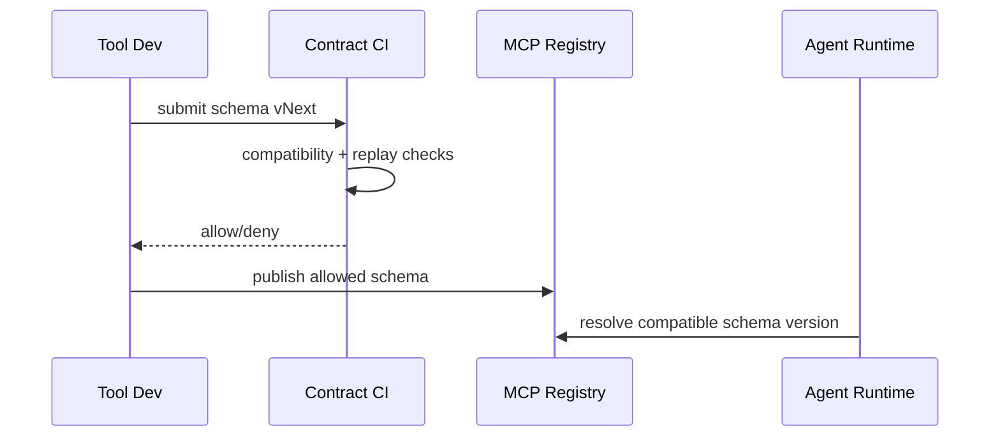

# MCP Schema 治理选型 FAQ（固定版本契约 vs 向后兼容演进）

> 专题边界：仅讨论 **MCP 工具契约（schema）发布与兼容治理**，不扩展到身份体系或沙箱供应链。

## 1) 📌 Executive Summary（3 分钟结论）

1. **生产默认建议“向后兼容演进 + 契约测试门禁”**，能在不中断现网的前提下持续迭代。  
2. **固定版本契约适合短期稳定窗口**，但长期会放大版本分叉和运维负担。  
3. **Schema 治理核心是“变更可验证、回退可执行、调用可追溯”**，而不是只看字段是否能解析。

## 2) 🎯 灵魂拷问 Q&A

### Q1：什么时候可以坚持固定版本契约？

- 高风险冻结窗口、审计期、或外部依赖尚未完成升级前。  
- 前提是你有明确的“冻结解除时间”和批量迁移计划。

### Q2：什么场景必须做向后兼容演进？

- 多租户 SaaS、MCP 工具多团队并行演进、调用方数量大且升级节奏不一致。  
- 需要不停机发布和灰度升级能力的场景。

### Q3：核心技术 X（Schema 契约门禁）是什么，怎么运作？

- **是什么（大白话）**：每次改 schema 都先跑“兼容安检”，不通过就不允许发布。  
- **解决痛点**：避免“服务端升级后，历史 agent/tool 调用突然报错”。  
- **底层运作**：schema diff 分类（新增/删除/破坏性）→ 兼容性测试 → 回放验证 → allow/deny。

## 3) 🧭 可视化图解（Mermaid）

## 4) 📊 Architect Decision Matrix

| 维度 | 固定版本契约 | 向后兼容演进 |
|---|---|---|
| 上线稳定性（短期） | 高 | 中-高 |
| 长期演进效率 | 低 | 高 |
| 兼容风险可控性 | 中 | 高 |
| 变更治理复杂度 | 低 | 中 |
| 生产默认建议 | 过渡方案 | ✅ |

## 5) 🧪 定量算例 + Benchmark 洞察

> 数据来源：`evidence/cycle-399-benchmark.json`。

| 指标 | 固定版本 | 向后兼容演进 |
|---|---:|---:|
| MCP 调用破坏率 | 7.9% | 1.8% |
| 兼容性回放通过率 | 86.4% | 97.2% |
| 发布窗口 P50 延迟抖动 | 190ms | 210ms |
| 回滚平均耗时 | 24min | 9min |
| 单会话治理成本增量 | $0.0003 | $0.0008 |

7-Card：`benchmark-cards.html` / `benchmark-cards.en.html`

## 6) 🛠️ Architect Checklist

- [ ] 每次 schema 改动必须输出兼容性 diff 分类
- [ ] 破坏性变更要求迁移计划与回滚脚本
- [ ] MCP 历史调用回放纳入发布门禁
- [ ] 注册中心保留可追溯版本与发布时间线
- [ ] 调用错误按“schema 版本”维度可观测
- [ ] 建立租户分批升级与灰度回退策略
- [ ] 每周复盘破坏性调用与迁移缺陷
