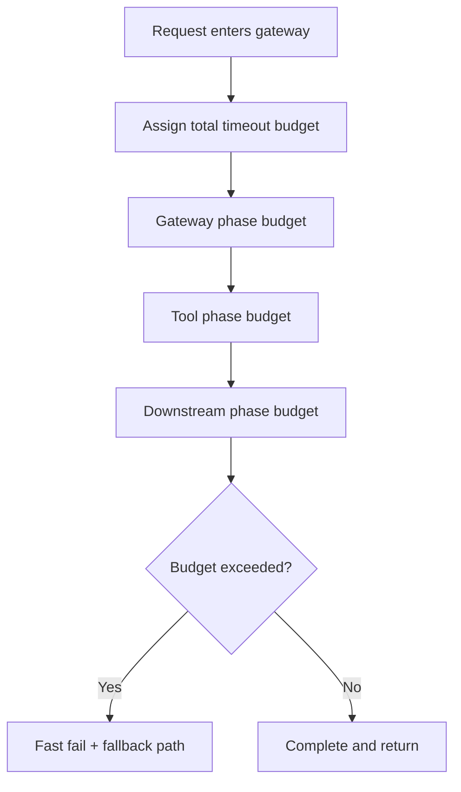
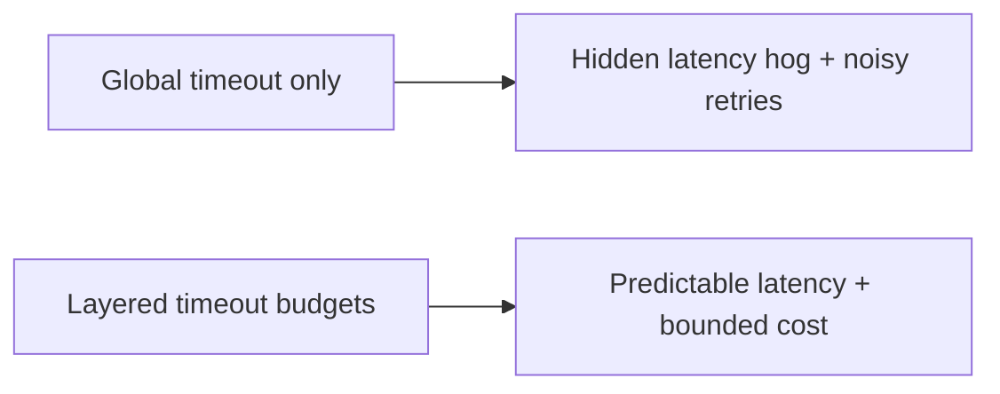
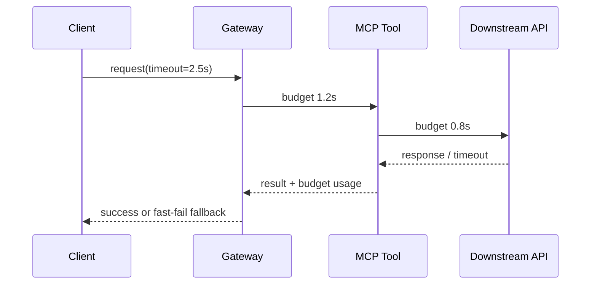

# MCP Timeout Budget Selection FAQ (Global Timeout vs Layered Timeout Budgets)

> Scope boundary: this FAQ focuses only on **timeout budgeting across MCP call chains**. It does not expand into identity architecture or supply-chain topics.

## 1) 📌 Executive Summary (3-minute take)

1. **Default production pattern: layered timeout budgets (Gateway/Tool/Downstream) with a strict total cap**.  
2. **Global-only timeout creates budget starvation** when one slow segment consumes the entire request window.  
3. **Timeout governance must achieve fast-fail behavior, retry safety, and cost control together**.

## 2) 🎯 Core Q&A

### Q1: When is a global timeout acceptable?

- Single-tool, short-chain, low-concurrency PoC environments.  
- Only when call depth is bounded and timeout waste is acceptable.

### Q2: When are layered budgets mandatory?

- Multi-tool MCP orchestration, long dependency chains, cross-region calls.  
- Multi-tenant high-concurrency workloads with tight latency and cost constraints.

### Q3: What is the key technique (layered timeout budgeting), and how does it work?

- **Plain words**: split total timeout into per-layer budgets so one slow step cannot sink the full request.  
- **Problem solved**: avoids end-to-end collapse when a single slow tool drains the entire latency allowance.  
- **Mechanism**: assign total budget at ingress → decrement per phase → timeout triggers fallback/retry/circuit-breaker → emit telemetry ledger.

## 3) 🧭 Visual breakdown (Mermaid)

## 4) 📊 Architect Decision Matrix

| Dimension | Global timeout | Layered timeout budgets |
|---|---|---|
| Latency predictability | Medium-Low | High |
| Chain stability | Medium | High |
| Ops complexity | Low | Medium |
| Cost control | Medium-Low | High |
| Production default | PoC-only | ✅ |

## 5) 🧪 Quantitative example + benchmark insight

> Data source: `evidence/cycle-401-benchmark.json`.

| Metric | Global timeout | Layered timeout budgets |
|---|---:|---:|
| Timeout storm trigger rate | 8.1% | 2.4% |
| P95 tail latency | 1420 ms | 980 ms |
| Retry amplification | 1.9x | 1.2x |
| Mean incident recovery duration | 21 min | 9 min |
| Governance cost increment per session | $0.0002 | $0.0008 |

7-Card: `benchmark-cards.html` / `benchmark-cards.en.html`

## 6) 🛠️ Architect checklist

- [ ] Define total ingress timeout and default per-layer allocations
- [ ] Set dedicated limits and fallback behavior for slow tools
- [ ] Make timeout events observable by tenant/tool dimensions
- [ ] Ensure retries are constrained by remaining budget
- [ ] Implement explicit fast-fail and fallback response paths
- [ ] Recalibrate thresholds and breaker settings periodically
- [ ] Drill downstream jitter + retry storm scenarios regularly
