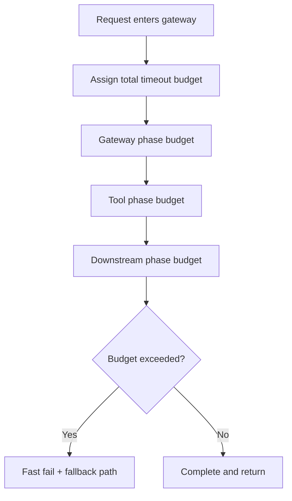
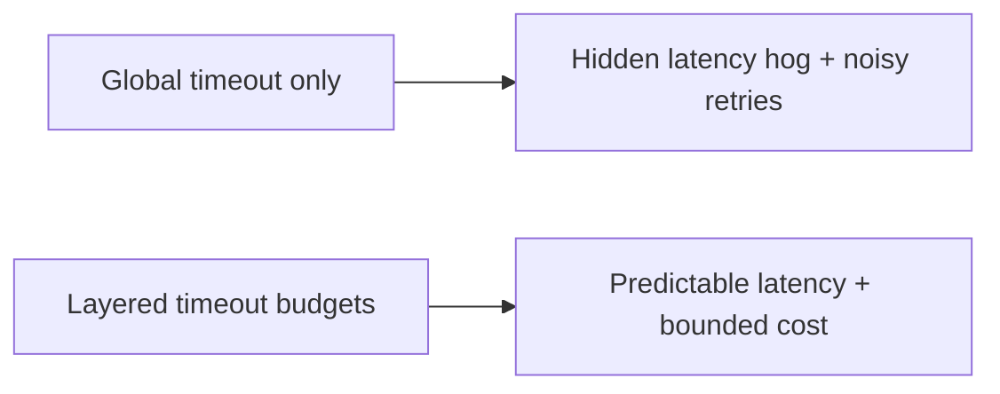
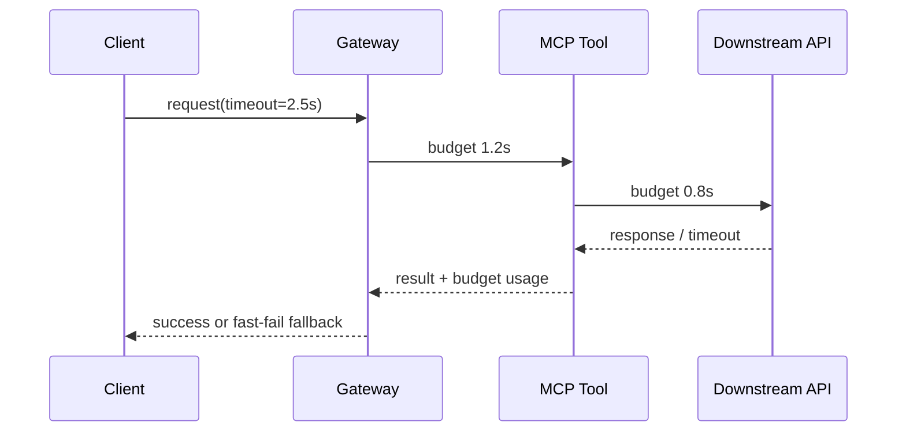

# MCP 超时预算选型 FAQ（全局超时 vs 分层超时预算）

> 专题边界：仅讨论 **MCP 调用链超时预算分配与超时治理**，不扩展到身份体系或供应链主题。

## 1) 📌 Executive Summary（3 分钟结论）

1. **生产默认建议“分层超时预算（Gateway/Tool/Downstream）+ 总预算上限”**，比单一全局超时更稳。  
2. **只有全局超时没有分层配额时，局部慢调用会挤爆整条链路预算**。  
3. **超时治理目标是“快速失败 + 可重试 + 成本可控”三者同时成立。**

## 2) 🎯 灵魂拷问 Q&A

### Q1：什么时候全局超时仍可接受？

- 单工具、短链路、低并发 PoC 场景。  
- 前提是调用深度可控，且超时成本可承受。

### Q2：什么场景必须采用分层超时预算？

- MCP 多工具编排、下游依赖多、跨区域调用链长。  
- 多租户并发高且对延迟、成本同时有约束时。

### Q3：核心技术 X（分层超时预算）是什么，怎么运作？

- **是什么（大白话）**：把总超时拆给每一层，谁超预算谁先失败，不拖垮全链路。  
- **解决痛点**：避免“某个慢工具”消耗完全部请求时间，导致其他关键步骤无法执行。  
- **底层运作**：入口分配 total budget → 每层扣减剩余 budget → 超时触发降级/重试/熔断 → 回写遥测账本。

## 3) 🧭 可视化图解（Mermaid）

## 4) 📊 Architect Decision Matrix

| 维度 | 全局超时 | 分层超时预算 |
|---|---|---|
| 延迟可预测性 | 中-低 | 高 |
| 链路稳定性 | 中 | 高 |
| 运维复杂度 | 低 | 中 |
| 成本可控性 | 中-低 | 高 |
| 生产默认建议 | 仅 PoC | ✅ |

## 5) 🧪 定量算例 + Benchmark 洞察

> 数据来源：`evidence/cycle-401-benchmark.json`。

| 指标 | 全局超时 | 分层超时预算 |
|---|---:|---:|
| 超时风暴触发率 | 8.1% | 2.4% |
| P95 尾延迟 | 1420ms | 980ms |
| 重试放大量 | 1.9x | 1.2x |
| 故障恢复平均耗时 | 21min | 9min |
| 单会话治理成本增量 | $0.0002 | $0.0008 |

7-Card：`benchmark-cards.html` / `benchmark-cards.en.html`

## 6) 🛠️ Architect Checklist

- [ ] 定义入口总预算与各层默认配额
- [ ] 对慢工具设置独立上限与降级策略
- [ ] 超时事件按租户/工具维度可观测
- [ ] 重试必须受剩余预算约束
- [ ] 建立快速失败与兜底返回路径
- [ ] 周期校准预算阈值与熔断参数
- [ ] 演练“下游抖动 + 重试风暴”场景
