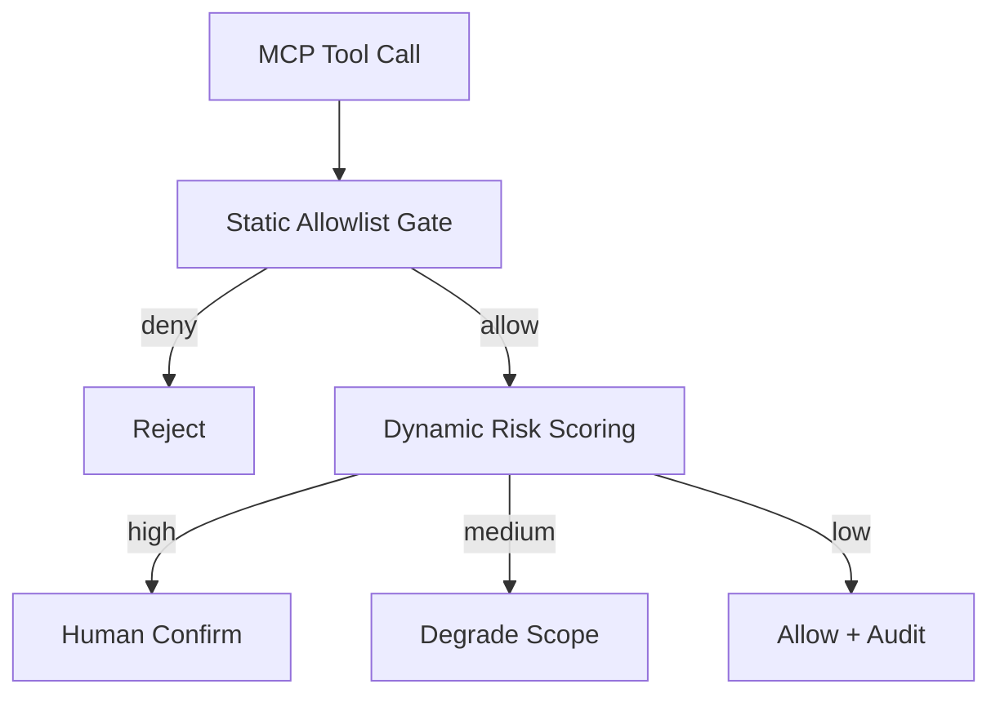
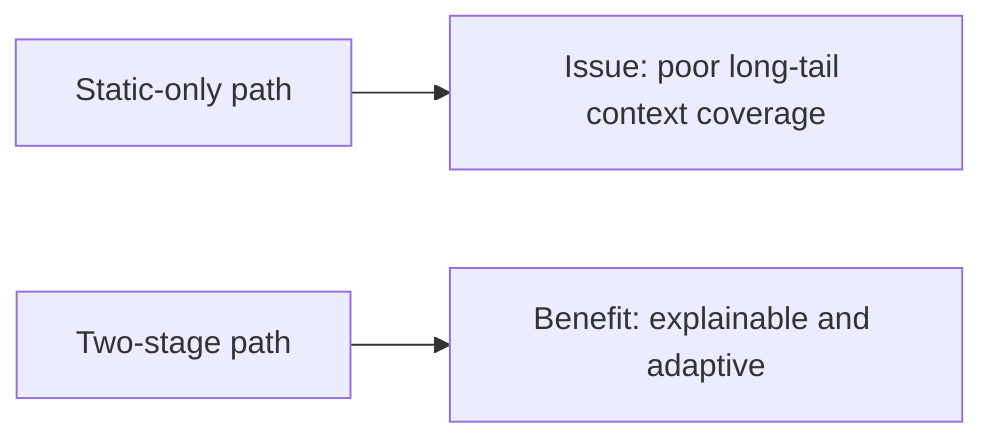
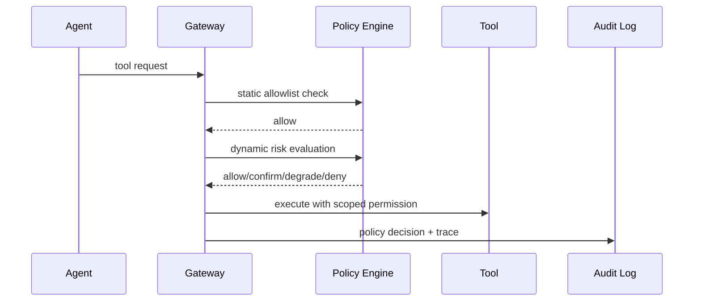

# MCP Tool Authorization Selection FAQ (Static Allowlist vs Dynamic Risk-Scored Authorization)

> Scope lock: this FAQ focuses only on **MCP tool-call authorization architecture**.

## 1) 📌 Executive Summary (3-minute read)

1. **Default recommendation is two-stage authorization: static allowlist + dynamic risk scoring.**  
2. **Static-only fits low-change tool surfaces** with predictable call paths.  
3. **Dynamic-only is risky for high-compliance workloads** because policy drift increases audit burden.

## 2) 🎯 Hard Questions Q&A

### Q1: When should static allowlist be primary?

- Tool surface is stable, operations are enumerable, and change frequency is low.  
- Main goal is controllability over flexibility.

### Q2: When is dynamic risk scoring strictly better?

- Tool ecosystem changes quickly and context sensitivity varies heavily across requests.  
- Team can operate higher policy complexity in exchange for finer-grained control.

### Q3: What is the core mechanism and how does it work?

- **What**: a policy decision graph combining caller identity, tool risk, context sensitivity, and budget.
- **Pain solved**: static-only rules either over-block or over-allow long-tail calls.
- **How**: static gate first, dynamic scoring second, then allow/deny/confirm/degrade.

## 3) 🧭 Visual Explanations (Mermaid)

## 4) 📊 Architect Decision Matrix

| Dimension | Static Allowlist | Dynamic Risk Scoring | Two-stage (Recommended) |
|---|---|---|---|
| Explainability | High | Medium | High |
| Flexibility | Low | High | Medium-high |
| Operational complexity | Low | High | Medium |
| Audit readiness | High | Medium | High |
| Default recommendation | Conditional | Conditional | ✅ |

## 5) 🧪 Quantitative Example + Benchmark Insight

> Data source: `evidence/cycle-391-benchmark.json`.

| Metric | Static | Dynamic | Two-stage |
|---|---:|---:|---:|
| High-risk false allow | 2.8% | 1.9% | 1.1% |
| False block rate | 1.2% | 3.6% | 1.9% |
| Auth latency p50 | 8ms | 24ms | 15ms |
| Audit explainability score | 92 | 78 | 90 |
| Governance cost per session | $0.0048 | $0.0063 | $0.0055 |

7-card: `benchmark-cards.html` / `benchmark-cards.en.html`

## 6) 🛠️ Architect Checklist

- [ ] Define tool risk tiers and high-risk action taxonomy
- [ ] Establish static baseline rules with change approval flow
- [ ] Build replay-driven threshold tuning for dynamic scoring
- [ ] Ensure policy canary rollout and one-click rollback
- [ ] Gate releases by false-allow and false-block KPIs
- [ ] Review decision explainability weekly
- [ ] Persist policy ID and context summary in audit logs
