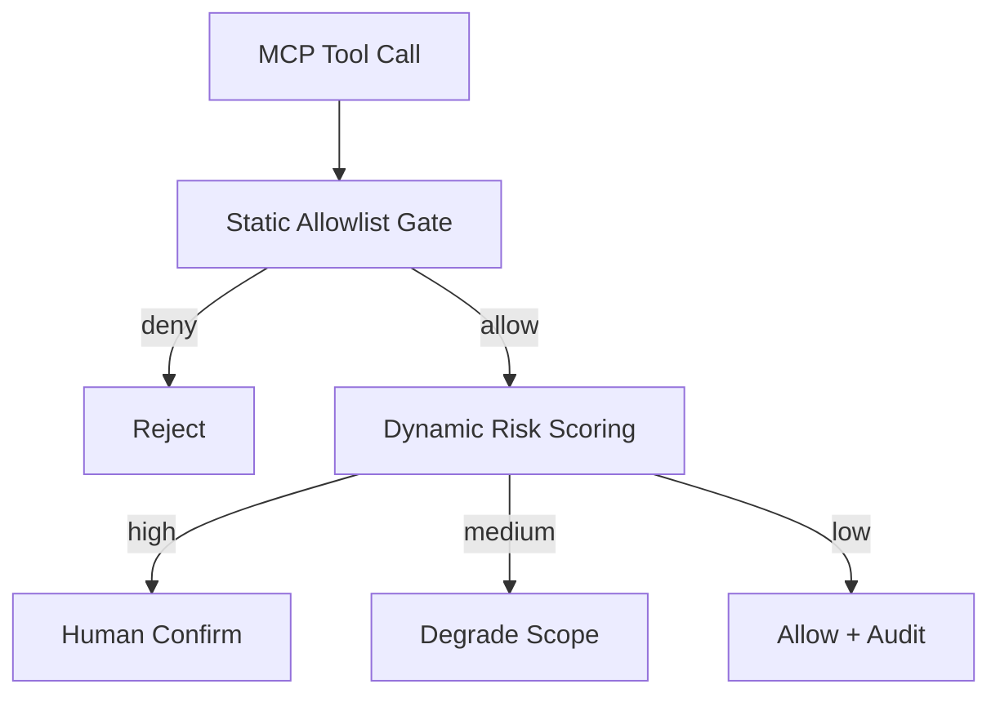
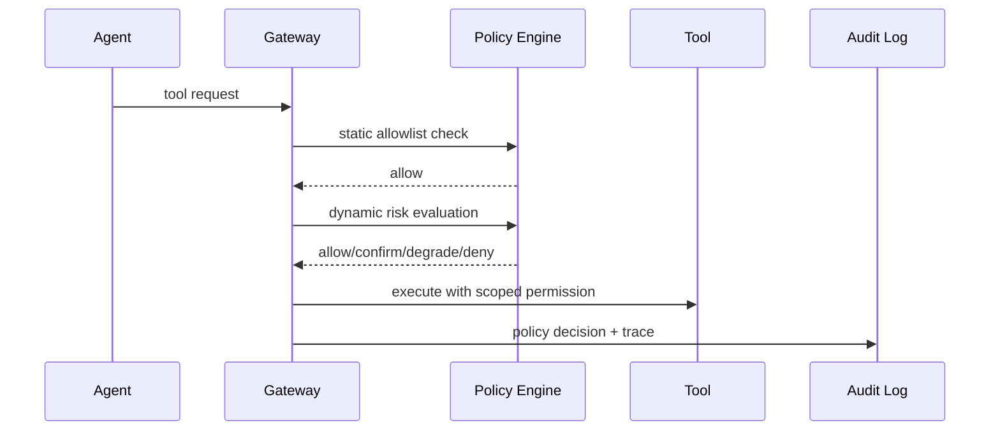

# MCP 工具授权选型 FAQ（静态 Allowlist vs 动态风险评分授权）

> 专题边界：仅讨论 **MCP 工具调用授权模型**，不展开 Runtime 与缓存选型。

## 1) 📌 Executive Summary（3 分钟结论）

1. **默认建议“静态 Allowlist + 动态风险评分二段式授权”**：既稳又能适配复杂场景。  
2. **仅静态 Allowlist 适合低变更场景**：简单可靠，但灵活性不足。  
3. **仅动态授权不适合高合规业务**：策略漂移和解释难度会放大审计成本。

## 2) 🎯 灵魂拷问 Q&A

### Q1：什么时候优先静态 Allowlist？

- 工具集合固定、操作路径可枚举、变更频率低。  
- 你的首要目标是“可控”而非“最大灵活”。

### Q2：什么场景动态风险评分严格更优？

- 工具生态变化快、上下文差异大，且希望按风险实时收敛授权范围。  
- 能接受更高策略运维复杂度以换取更细粒度控制。

### Q3：核心技术 X（Policy Decision Graph）是什么，怎么运作？

- **是什么**：把调用者身份、工具风险、上下文敏感度、预算上限组合成决策图。  
- **解决痛点**：单一静态规则难覆盖长尾场景，且容易“过度放行或过度拦截”。  
- **底层运作**：先静态门禁过滤，再动态打分，输出 allow/deny/confirm/degrade。

## 3) 🧭 可视化图解（Mermaid）

## 4) 📊 Architect Decision Matrix

| 维度 | 静态 Allowlist | 动态风险评分 | 二段式（推荐） |
|---|---|---|---|
| 可解释性 | 高 | 中 | 高 |
| 灵活性 | 低 | 高 | 中-高 |
| 运维复杂度 | 低 | 高 | 中 |
| 审计友好度 | 高 | 中 | 高 |
| 默认建议 | 条件适配 | 条件适配 | ✅ |

## 5) 🧪 定量算例 + Benchmark 洞察

> 数据来源：`evidence/cycle-391-benchmark.json`。

| 指标 | 静态 | 动态 | 二段式 |
|---|---:|---:|---:|
| 高风险误放行率 | 2.8% | 1.9% | 1.1% |
| 误拦截率 | 1.2% | 3.6% | 1.9% |
| p50 授权延迟 | 8ms | 24ms | 15ms |
| 审计可解释分 | 92 | 78 | 90 |
| 单会话治理成本 | $0.0048 | $0.0063 | $0.0055 |

7-Card：`benchmark-cards.html` / `benchmark-cards.en.html`

## 6) 🛠️ Architect Checklist

- [ ] 明确工具分级与高危动作定义
- [ ] 建立静态规则基线与变更审批
- [ ] 建立动态评分特征与阈值回放机制
- [ ] 关键策略支持灰度和一键回滚
- [ ] 误放行/误拦截纳入发布门禁
- [ ] 每周复盘授权决策可解释性
- [ ] 审计日志保留策略ID与上下文摘要
