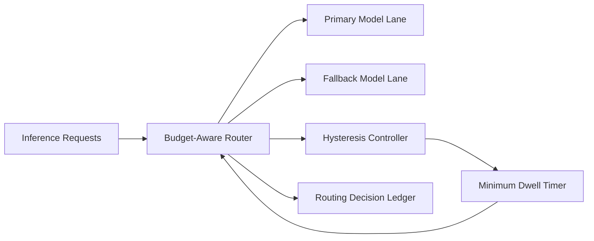

# Model Router Budget-Aware Hysteresis Selection FAQ (Cycle 1788)

## 1) Three-minute decision
- **Routing flaps are often caused by over-sensitive threshold switching, not isolated model variance.**
- **Recommendation:** dual budget awareness (latency + cost), hysteresis bands, and minimum dwell windows.
- **Goal:** reduce oscillation-driven quality/cost noise and stabilize critical-path experience.

## 2) Core questions (Q1/Q2/Q3)
### Q1: Why do simple thresholds flap?
1) metrics oscillate around cutoffs,
2) switch-over costs are ignored,
3) transient spikes trigger false degradations.

### Q2: What is the minimum viable hysteresis setup?
- dual budgets for latency and cost,
- separated enter/exit thresholds,
- minimum dwell timers after each switch.

### Q3: How to validate stability gains?
- fewer switches per time unit,
- stable critical-task success,
- converged volatility in cost/latency curves.

## 3) Reference architecture

## 4) Decision matrix
| Dimension | Instant threshold switching | Budget-aware + hysteresis + dwell (Recommended) |
|---|---:|---:|
| Switching stability | Low | High |
| Quality consistency | Medium | High |
| Cost predictability | Low | High |
| Implementation complexity | Low | Medium |
| Explainability | Medium | High |

## 5) Evidence and reproducibility
- Evidence files:
  - `workshops/azure-agent-infra/evidence/cycle-1788-benchmark.json`
  - `workshops/azure-agent-infra/evidence/cycle-1788-latency.csv`
  - `workshops/azure-agent-infra/evidence/cycle-1788-throughput.csv`
  - `workshops/azure-agent-infra/evidence/cycle-1788-cost.csv`
- Labels: `measured / synthetic / anonymized_reported`.
- validation7 requires bilingual structure, CSP self-contained cards, evidence consistency, and replayability trace.

## 6) Production checklist
- [ ] Latency/cost budget thresholds are independently tunable.
- [ ] Hysteresis and dwell controls support canary rollout.
- [ ] Switch reasons are traceable to metric snapshots.
- [ ] Routing-switch events are ledgered.
- [ ] FAQ/H5/SVG/7-card references are cycle-aligned.
